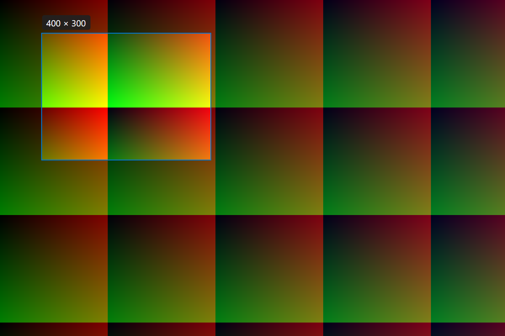
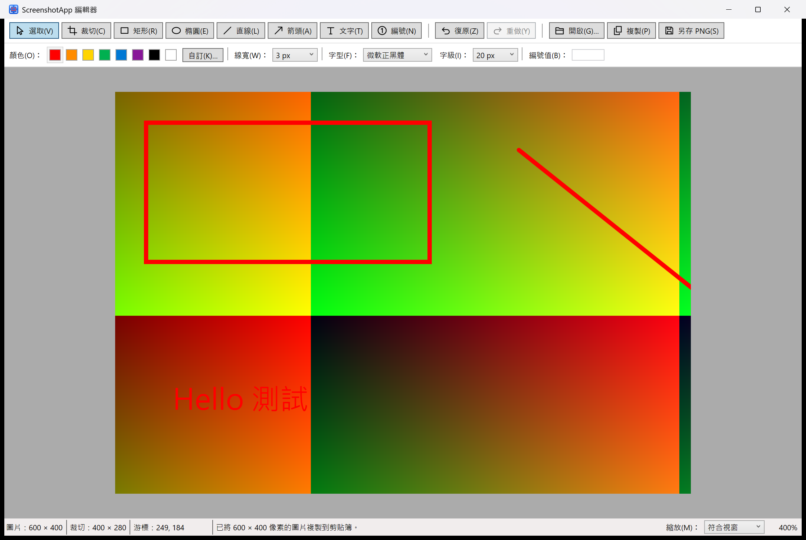

# ScreenshotApp

[繁體中文](README_zh_TW.md) · [Download](https://github.com/anthonywang6503/ScreenshotApp/releases/latest) · [User guide](docs/USER_GUIDE.md)

A lightweight, native Windows screenshot and annotation tool. Capture a region with a hotkey, add annotations, and copy or save the result as PNG. Runs locally in the system tray, with no account, network connection or administrator privileges required.

**Version 1.3.1** adds English and Traditional Chinese interfaces. English is the default, including upgrades from versions without a language preference. Choose **Settings → Interface language**, save, exit from the tray and restart to switch languages.

## Features

- Native .NET 10 WPF and Win32 application with Per-Monitor V2 DPI support and physical-pixel capture.
- Rectangle, ellipse, line, arrow, text, numbered steps, crop, mosaic, blur, ruler and color picker.
- Magnifier, pixel-color copying and measurement during region selection.
- Undo/redo, contextual menus, zoom/pan and prompts for changes not yet copied or saved.
- Clipboard PNG and bitmap formats; PNG export; open PNG, JPEG and BMP images.
- Local editable capture history and manual/automatic vertical scrolling capture.
- Portable, self-contained Windows x64 distribution; no separate .NET installation required.

**Privacy:** local history is enabled by default and stores unencrypted originals and annotations, including content before cropping or masking. Disable **Keep capture history** before capturing sensitive content, and use **Clear all** to delete existing entries. Blur and mosaic are not secure deletion. See [limitations](docs/KNOWN_LIMITATIONS.md).

## Download and run

1. Download `ScreenshotApp-1.3.1-win-x64.zip` from [Releases](https://github.com/anthonywang6503/ScreenshotApp/releases/tag/v1.3.1).
2. Extract the complete folder and run `ScreenshotApp.exe`. Keep the accompanying files, including the `zh-TW` resource folder.
3. Find the icon in the notification area (possibly under hidden icons). Press **Ctrl+Shift+2** and drag to capture a region.

Windows 11 x64 is the target platform. Windows 10 x64 is best-effort and unverified. Binaries are unsigned, so Windows SmartScreen or organizational policy may block them. There is no installer or automatic updater. Verify the ZIP using the release's `SHA256SUMS.txt`:

```powershell
Get-FileHash .\ScreenshotApp-1.3.1-win-x64.zip -Algorithm SHA256
```

The downloadable package uses a folder layout. Single-file builds are withheld until that version passes the required interactive smoke tests. Automated tests do not establish clean-machine, mixed-DPI, clipboard-application or scrolling-target compatibility; see [acceptance](docs/ACCEPTANCE.md).

## Screenshots

These images show earlier Traditional Chinese builds (v1.0/v1.1), not the current English toolbar or settings.





## Build and test

Requires Windows x64, PowerShell 7, Git and **.NET SDK 10.0.403**, pinned by [global.json](global.json).

```powershell
pwsh -NoProfile -File tools/Invoke-Quality.ps1
```

This runs locked restore, a Release build with warnings treated as errors, and all tests, rejecting missing or skipped tests. See [quality checks](docs/QUALITY.md) and [contributing](CONTRIBUTING.md). The application has no direct NuGet dependencies; xunit is used for tests.

After committing and tagging a version, create self-contained archives with:

```powershell
pwsh -NoProfile -File tools/Publish-Release.ps1
```

Output goes to the ignored `publish/` directory. See [release procedure](docs/RELEASING.md) for verification and GitHub upload steps.

## Project and documentation

| Location | Purpose |
| --- | --- |
| [ScreenshotApp/](ScreenshotApp/) | WPF application: Platform, Capture, Editor, Export, History, Settings, Resources |
| [ScreenshotApp.Tests/](ScreenshotApp.Tests/) | Automated WPF/Win32 and model tests |
| [tools/](tools/) | Quality checks, packaging and interactive smoke scripts |
| [docs/](docs/README.md) | User/developer documentation and preserved acceptance evidence |

- [User guide](docs/USER_GUIDE.md) / [繁體中文](docs/USER_GUIDE_zh_TW.md)
- [Known limitations](docs/KNOWN_LIMITATIONS.md) / [繁體中文](docs/KNOWN_LIMITATIONS_zh_TW.md)
- [Architecture](docs/ARCHITECTURE.md), [specification](docs/ScreenshotApp.Spec.md), [acceptance](docs/ACCEPTANCE.md)
- [Contributing](CONTRIBUTING.md), [security reporting](SECURITY.md), [changelog](CHANGELOG.md)
- [Third-party notices](THIRD-PARTY-NOTICES.md), [license](LICENSE)

## License

Copyright 2026 Anthony Wang. Licensed under the [Apache License 2.0](LICENSE). Self-contained downloads include .NET and Windows Desktop Runtime components and their licenses; see [third-party notices](THIRD-PARTY-NOTICES.md).
