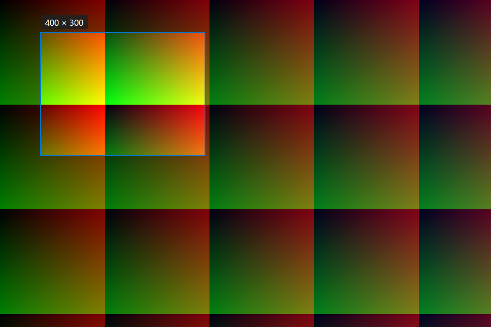
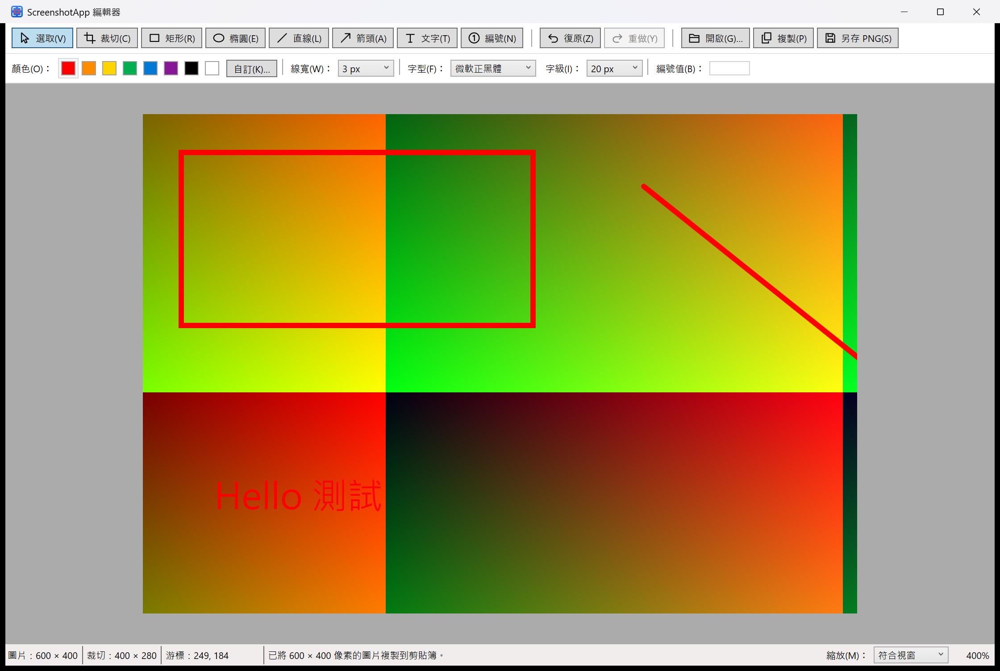
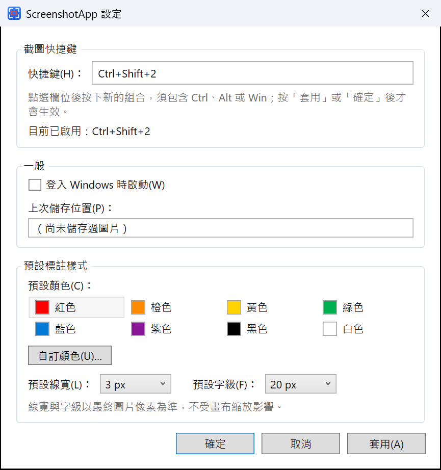

# ScreenshotApp

Windows 原生的輕量截圖與圖片標註工具：常駐系統匣，以快捷鍵選取畫面，在編輯器加入方框、箭頭、文字、步驟編號或裁切後，複製到剪貼簿或另存 PNG。完全本機離線運作，不需要系統管理員權限、帳號或網路。

目前版本：**1.1.0**（加入依情境的右鍵選單、再製與重新編號等編輯操作，裁切後以裁切範圍填滿畫布）。各版本的功能與驗證結果記錄於 [CHANGELOG.md](CHANGELOG.md)。

## 特點

- **Windows 原生**：以 .NET 10 WPF 與 Win32 API 開發的桌面程式，不是網頁或 Electron 包裝。以 GDI 直接擷取畫面，支援 Per-Monitor V2 高 DPI 與多螢幕；截圖尺寸以螢幕實體像素為準，在 175% 縮放的螢幕上選取 100 × 50 像素，得到的就是 100 × 50 像素的圖片。
- **免安裝**：自包含發佈，不需要另外安裝 .NET，解壓縮即可執行；以目前使用者的權限執行，不需要系統管理員權限。
- **簡單**：只做「截圖 → 標註 → 複製或另存」這件事。程式常駐系統匣、沒有主視窗；編輯器只有選取、裁切、矩形、橢圓、直線、箭頭、文字、步驟編號八種工具。
- **易用**：按下快捷鍵（預設 `Ctrl+Shift+2`）、拖曳選取，截圖就在編輯器中開啟。常用操作都有快捷鍵，右鍵選單依位置提供對應的操作；可復原 100 步，關閉前會提醒尚未複製或儲存的修改。
- **快速**：實測按下快捷鍵到選取畫面出現約 154 ms（3456 × 2160 螢幕），放開滑鼠到編輯器出現約 91 ms（中位數，見[驗收紀錄](docs/ACCEPTANCE.md)）。
- **貼上即用**：剪貼簿同時提供 PNG 與點陣圖，PowerPoint、Word、Teams、小畫家都可以直接貼上；複製與另存的圖片像素完全相同。
- **重視隱私**：不需要帳號、不連線網路、不上傳任何資料；截圖與標註只存在記憶體中，只有另存 PNG 時才寫入你選擇的檔案。
- **繁體中文介面**：介面與錯誤訊息都是台灣繁體中文，文字工具支援微軟注音輸入。

## 畫面

畫面中的漸層色塊是實機煙霧驗證使用的測試圖樣。

**區域選取**：按下快捷鍵後所有顯示器的畫面凍結並變暗，拖曳選取時顯示實際的像素寬高。



**編輯器**：上方是工具列與屬性列（顏色、線寬、字型、字級、編號值），下方狀態列顯示圖片與裁切尺寸、游標座標與縮放比例。圖中加上矩形、線條與文字標註後套用裁切，畫布以裁切範圍放大填滿。



**設定**：截圖快捷鍵、登入 Windows 時啟動，以及新增標註的預設顏色、線寬與字級。



## 下載與執行

到 [Releases](https://github.com/anthonywang6503/ScreenshotApp/releases) 下載 Windows 11 x64 的自包含版本，不需要另外安裝 .NET：

- `ScreenshotApp-1.1.0-win-x64.zip`：資料夾版本，解壓縮後執行 `ScreenshotApp.exe`。
- `ScreenshotApp-1.1.0-win-x64-singlefile.zip`：只有一個 `ScreenshotApp.exe` 的版本。

程式啟動後只在系統匣常駐，預設截圖快捷鍵為 `Ctrl+Shift+2`。安裝、截圖、編輯、複製與另存、設定與移除方式見 [使用說明](docs/USER_GUIDE.md)。

## 系統需求

- 執行：Windows 11 x64（Windows 10 x64 盡力相容）。
- 開發：.NET SDK 10.0.403（由 [global.json](global.json) 固定；`net10.0-windows`，含 WPF 與 Windows Forms）。

## 建置、測試與發佈

本機與 Windows CI 共用完整品質檢查入口：`pwsh -NoProfile -File tools/Invoke-Quality.ps1`，包含鎖定套件還原、Release 零警告建置及完整測試。環境、負向驗證與 CI 的驗證範圍見 [品質檢查說明](docs/QUALITY.md)。個別命令如下：

```powershell
dotnet build ScreenshotApp.sln -c Release
dotnet test ScreenshotApp.sln -c Release
pwsh -NoProfile -File tools/Publish-Release.ps1
```

- 套件來源由專案根目錄的 [nuget.config](nuget.config) 指定為 nuget.org，不影響使用者全域設定。應用程式本身不引用任何 NuGet 套件。
- 開發時的執行檔：`ScreenshotApp\bin\Release\net10.0-windows\ScreenshotApp.exe`。
- `tools/Publish-Release.ps1` 以 `dotnet publish -c Release -r win-x64 --self-contained true` 產生資料夾版與單檔版，連同授權檔與使用文件輸出到 `publish/`（不納入版本控制），並建立兩個 ZIP。封裝方式的決策見 [ADR-0017](docs/adr/0017-release-packaging.md)。
- 實機煙霧驗證腳本在 [tools/smoke/](tools/smoke/)，會實際啟動程式並模擬滑鼠鍵盤操作；開始前會等待電腦閒置，執行期間請勿操作電腦。

## 專案結構

```
ScreenshotApp/            WPF 應用程式（net10.0-windows）
  Platform/               Win32 互操作、快捷鍵、系統匣、顯示器列舉、GDI 擷取、單一執行個體、開機啟動、故障日誌
  Capture/                截圖流程、座標換算、區域選取覆蓋層
  Editor/                 編輯視窗、編輯工作階段（工具邏輯）、標註層與控制點層、縮放階段
  Editor/Model/           圖片文件、標註與像素座標模型
  Editor/Commands/        編輯命令與復原／重做歷史
  Editor/Rendering/       標註繪製（畫面與輸出共用）
  Export/                 圖片合成、剪貼簿、PNG 檔案、開啟圖片
  Settings/               設定模型、JSON 持久化、設定視窗
  Resources/              介面文字（Strings.resx，台灣繁體中文）與應用程式圖示
ScreenshotApp.Tests/      xunit 自動化測試
docs/                     使用說明、架構、驗收紀錄、已知限制、架構決策紀錄（adr/）
tools/                    圖示產生、發佈、實機煙霧驗證（smoke/）
```

## 文件

- [使用說明](docs/USER_GUIDE.md)：快捷鍵、編輯器、複製與存檔、設定、本機資料與移除
- [架構](docs/ARCHITECTURE.md)：模組關係、圖片資料模型、座標系統、狀態機
- [驗收紀錄](docs/ACCEPTANCE.md)：自動化測試、Agent 端煙霧驗證與使用者實機驗收
- [已知限制](docs/KNOWN_LIMITATIONS.md)
- [架構決策紀錄](docs/adr/)
- [第三方聲明](THIRD-PARTY-NOTICES.md)
- [授權條款](LICENSE)

## 授權

本專案以 [Apache License 2.0](LICENSE) 授權。發佈版本內含的 .NET Runtime 與 Windows Desktop Runtime 依 MIT 授權散布，見[第三方聲明](THIRD-PARTY-NOTICES.md)。

```text
Copyright 2026 Anthony Wang

Licensed under the Apache License, Version 2.0 (the "License");
you may not use this file except in compliance with the License.
You may obtain a copy of the License at

    http://www.apache.org/licenses/LICENSE-2.0

Unless required by applicable law or agreed to in writing, software
distributed under the License is distributed on an "AS IS" BASIS,
WITHOUT WARRANTIES OR CONDITIONS OF ANY KIND, either express or implied.
See the License for the specific language governing permissions and
limitations under the License.
```
