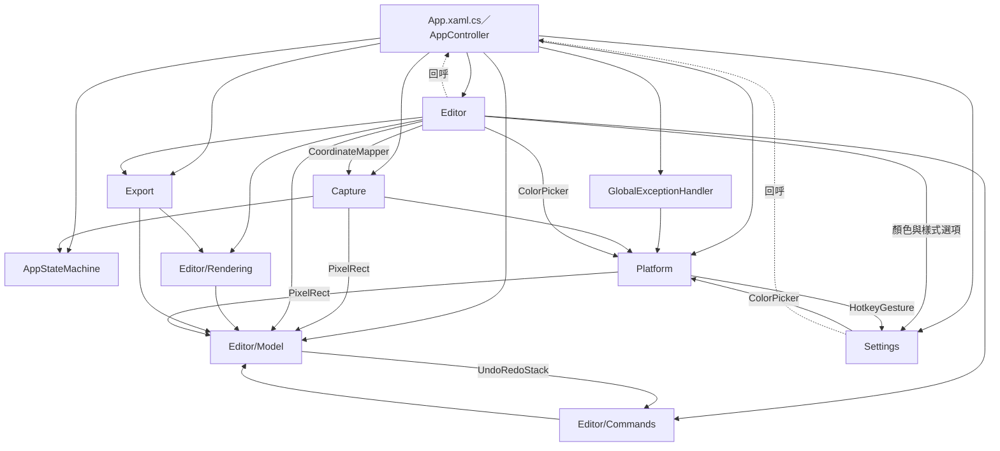
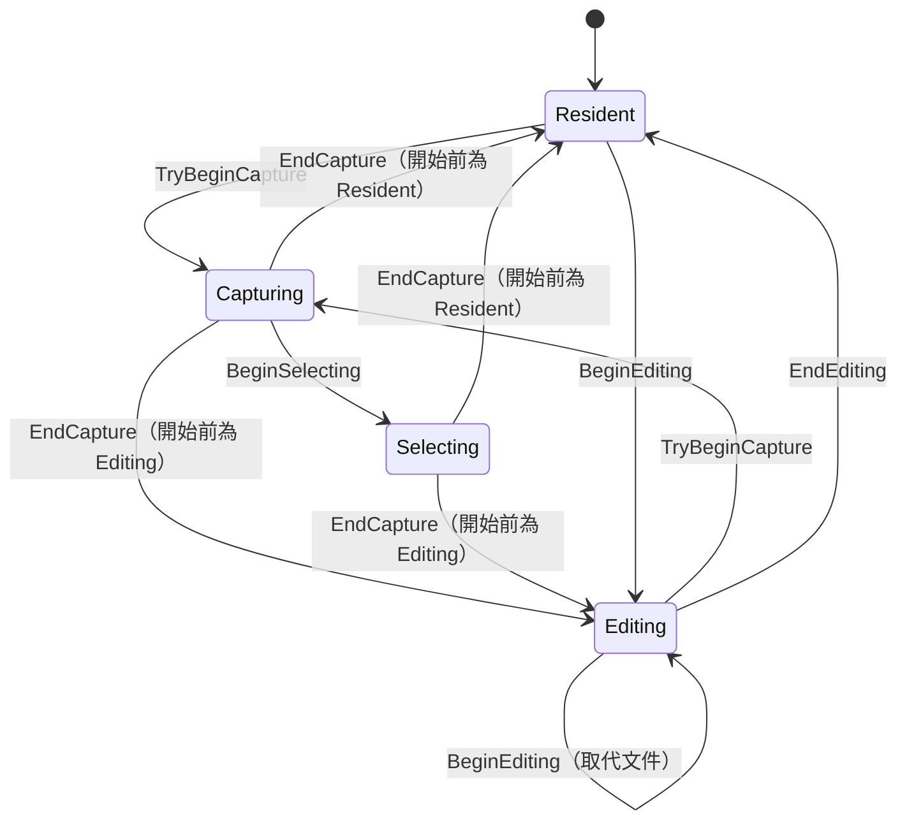
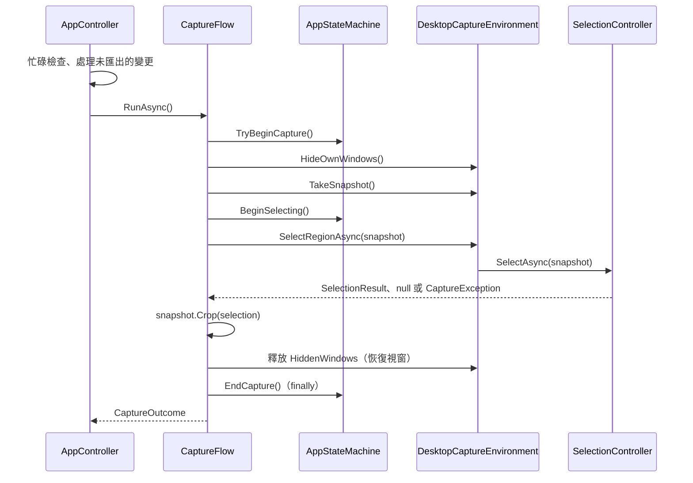

# ScreenshotApp 架構說明

本文說明 ScreenshotApp 目前程式碼的結構與執行流程，讀者是接手維護的開發者。使用方式見[使用說明](USER_GUIDE.md)，建置與發佈見 [README](../README.md)，功能限制見[已知限制](KNOWN_LIMITATIONS.md)，各項決策的背景見第 15 節的架構決策紀錄（ADR）。本文與程式碼不一致時，以程式碼為準。

## 1. 總覽

ScreenshotApp 是常駐 Windows 11 系統匣的截圖與圖片標註工具：以全域快捷鍵或系統匣選單凍結桌面、在單一顯示器內拖曳選取範圍，在編輯器加入矩形、橢圓、直線、箭頭、文字、步驟編號或裁切後，複製到剪貼簿或另存 PNG；也可以開啟既有的 PNG、JPEG、BMP 圖片編輯。程式沒有任何網路存取，以目前使用者的權限執行（`app.manifest` 宣告 `asInvoker`）。

方案只有兩個專案：

- [ScreenshotApp](../ScreenshotApp/ScreenshotApp.csproj)：`net10.0-windows` 的 WPF 可執行檔。`UseWindowsForms` 只為了系統匣與色彩對話框，並移除 Windows Forms 與 `System.Drawing` 的隱含 `using`，避免與 WPF 型別名稱衝突。不引用任何 NuGet 套件；以 `InternalsVisibleTo` 對測試專案開放 `internal` 型別。
- [ScreenshotApp.Tests](../ScreenshotApp.Tests/ScreenshotApp.Tests.csproj)：xunit 測試專案，以 `ProjectReference` 引用應用程式。

| 位置 | 職責 |
|---|---|
| 根目錄 | [App.xaml.cs](../ScreenshotApp/App.xaml.cs)（啟動、結束、登出）、[AppController](../ScreenshotApp/AppController.cs)（建立並連接常駐服務、協調各流程）、[AppStateMachine](../ScreenshotApp/AppStateMachine.cs)、[GlobalExceptionHandler](../ScreenshotApp/GlobalExceptionHandler.cs) |
| `Platform/` | Win32 互操作（宣告集中於 [NativeMethods](../ScreenshotApp/Platform/NativeMethods.cs)，使用 `LibraryImport`）、全域快捷鍵、系統匣、顯示器列舉、GDI 擷取與 SafeHandle、單一執行個體、登入時啟動、DPI 感知檢查、故障日誌、色彩對話框 |
| `Capture/` | 截圖流程、選取覆蓋層與拖曳幾何、自繪十字游標、座標換算 [CoordinateMapper](../ScreenshotApp/Capture/CoordinateMapper.cs) |
| `Editor/` | 編輯視窗、編輯工作階段（工具邏輯）、標註層與控制點層、縮放階段、未匯出變更對話框 |
| `Editor/Model/` | 圖片文件、不可變的標註 record、`PixelRect`／`PixelPoint`、控制點、命中幾何、文字版面 |
| `Editor/Commands/` | 六種編輯命令（含把多個命令當成一筆的複合命令）與 `UndoRedoStack` |
| `Editor/Rendering/` | [AnnotationPainter](../ScreenshotApp/Editor/Rendering/AnnotationPainter.cs)：畫面與輸出共用的標註繪製碼 |
| `Export/` | 圖片合成、剪貼簿、PNG 存檔、開啟圖片 |
| `Settings/` | 設定模型與 JSON 持久化、快捷鍵組合、顏色與樣式選項、設定視窗 |
| `Resources/` | `Strings.resx`、`Strings` 存取類別、XAML 標記延伸、常見錯誤的繁體中文說明（`ErrorText`）、應用程式圖示 |

### 相依方向

箭頭表示「引用」，依各檔案的 `using` 與實際呼叫整理。這不是嚴格的分層：`Platform` 引用 `Editor/Model` 的 `PixelRect` 與 `Settings` 的 `HotkeyGesture`；`Editor` 引用 `Capture` 的 `CoordinateMapper`；`ImageDocument` 持有 `UndoRedoStack`，所以 `Editor/Model` 與 `Editor/Commands` 互相引用；編輯視窗與設定視窗都持有 `AppController` 並回呼它（虛線）。`Resources` 被幾乎所有資料夾引用、本身不引用其他資料夾，圖中省略。

## 2. 啟動與生命週期

[App.xaml](../ScreenshotApp/App.xaml) 設定 `ShutdownMode="OnExplicitShutdown"`：程式沒有主視窗，關閉任何視窗都不會結束程式，只有明確呼叫 `Shutdown` 才會結束。`App.OnStartup` 的順序：

1. `SingleInstanceGuard.TryAcquire()` 失敗（已有執行個體）時立即 `Shutdown()`，不建立任何服務。
2. 以 `FrameworkElement.LanguageProperty.OverrideMetadata` 把預設語言設為 zh-TW，讓字型後援選用繁體字形。
3. 建立 `ErrorLog` 並刪除過期的日誌檔，建立 `GlobalExceptionHandler` 並掛到 `Dispatcher`。
4. 目前執行緒不是 Per-Monitor V2 DPI 感知時只寫一筆日誌，不中止。
5. 建立 `SettingsStore`、`StartupService` 與 `AppController`，呼叫 `Start(store.Load())`，之後才開始等待第二個執行個體的喚醒。
6. 第 5 步拋出例外時寫入日誌、顯示錯誤並 `Shutdown(1)`：沒有系統匣可操作的常駐程式只會成為看不見的處理程序。

`AppController.Start` 套用載入的設定並收集提示：設定檔不存在、損毀或有無效欄位時寫回一份（讀取失敗時不寫回，以免覆蓋只是暫時讀不到的有效設定檔）；註冊快捷鍵；依偏好同步登入時啟動的登錄值；最後才顯示系統匣圖示，圖示出現即代表常駐服務已就緒。有提示時以系統匣通知顯示（快捷鍵註冊失敗用錯誤圖示，其餘用警告圖示）。

| 常駐元件 | 作法 |
|---|---|
| [SingleInstanceGuard](../ScreenshotApp/Platform/SingleInstanceGuard.cs) | 以 `Local\` 具名 `Mutex` 是否已存在判斷（不持有擁有權）。後啟動者先 `AllowSetForegroundWindow(ASFW_ANY)` 讓出前景權限，再 `Set` 具名的 AutoReset 事件後結束；無權限開啟具名物件時同樣視為已有執行個體。第一個執行個體以 `ThreadPool.RegisterWaitForSingleObject` 等待，回呼由 `App` 以 `Dispatcher.BeginInvoke` 轉到 UI 執行緒呼叫 `ActivateFromSecondInstance`：編輯中帶出編輯視窗，否則顯示設定視窗 |
| [HotkeyService](../ScreenshotApp/Platform/HotkeyService.cs) | `RegisterHotKey`（加上 `MOD_NOREPEAT`），`WM_HOTKEY` 由 `HWND_MESSAGE` 的 `HwndSource` 訊息視窗接收，模態對話框期間也收得到。變更組合時以另一個識別碼先註冊新組合，成功後才解除舊組合；失敗時保留原本的註冊 |
| [TrayService](../ScreenshotApp/Platform/TrayService.cs) | Windows Forms `NotifyIcon`＋`ContextMenuStrip`（開始截圖、開啟圖片、設定、結束），左鍵雙擊開啟設定；程式不呼叫 Windows Forms 的 `Application.Run`。圖示依小圖示系統尺寸從內嵌的 `app.ico` 載入；工具提示顯示快捷鍵是否生效，工具提示與通知文字超過長度上限時截斷 |
| [SettingsWindow](../ScreenshotApp/Settings/SettingsWindow.xaml.cs) | 同時只有一個；變更經 `AppController.ApplySettings` 套用（第 11 節） |

系統匣的「開始截圖」「開啟圖片」「結束」以 `Dispatcher.BeginInvoke` 延後到選單事件處理結束後執行（`RunAfterMenuCloses`）：選單先從畫面移除才不會被截入，也不會在選單事件中途開啟對話框或釋放系統匣圖示。快捷鍵直接呼叫 `StartCapture`。

**結束**：系統匣「結束」呼叫 `RequestExit`：忙碌時忽略，否則先處理未匯出的變更（第 10 節），再以 `CloseWithoutConfirmation` 關閉編輯器並 `Application.Shutdown()`。`Shutdown` 關閉視窗時不能取消，詢問必須在呼叫之前完成。`App.OnExit` 依序呼叫 `AppController.Dispose`（關閉設定視窗、不詢問地關閉編輯器、解除快捷鍵、移除系統匣圖示）與 `SingleInstanceGuard.Dispose`。

**登出或關機**：`App.OnSessionEnding` 轉給 `AppController.OnSessionEnding`。編輯器在提交進行中的文字輸入後仍有未匯出的變更時，設定 `e.Cancel = true` 拒絕結束工作階段，並以 `BeginInvoke` 排入 `RequestCloseEditor` 詢問；使用者處理後需重新登出或關機。沒有未匯出的變更時不攔截。

**全域例外處理**：[GlobalExceptionHandler](../ScreenshotApp/GlobalExceptionHandler.cs) 在啟動時掛上三個事件，之後不解除（`Detach` 只有測試使用）。

| 事件 | 處理 |
|---|---|
| `Dispatcher.UnhandledException` | 寫入日誌、設 `Handled = true` 讓常駐程式繼續執行，再以訊息方塊告知（含日誌路徑）；訊息方塊開著時再發生的例外只記錄，不連續跳出視窗 |
| `TaskScheduler.UnobservedTaskException` | 寫入日誌並 `SetObserved()` |
| `AppDomain.CurrentDomain.UnhandledException` | 只能寫入日誌 |

`App` 轉送喚醒時刻意用 `BeginInvoke` 而非 `InvokeAsync`：前者的例外會交給 `Dispatcher.UnhandledException`，後者會被存進工作而遭忽略。除了這三個事件，寫入故障日誌的只有啟動失敗、DPI 感知不符與截圖失敗。日誌的格式與限制見第 11 節。

## 3. 應用程式狀態機

[AppStateMachine](../ScreenshotApp/AppStateMachine.cs) 只在 UI 執行緒使用，狀態為 `Resident`（常駐）、`Capturing`（隱藏視窗並擷取快照）、`Selecting`（覆蓋層選取中）與 `Editing`（編輯視窗開著一份文件）。`TryBeginCapture` 把開始前的狀態記在 `_beforeCapture`，`EndCapture` 回到該狀態，所以截圖可以從常駐或編輯中開始，結束後回到原本的狀態。

- **重入保護**：`Capturing` 或 `Selecting` 時再要求截圖，`TryBeginCapture` 回傳 `false`，`CaptureFlow` 以 `Ignored` 結束。其他不合法的轉換代表程式錯誤，直接拋出 `InvalidOperationException`，不靜默略過。
- **完成截圖**：`CaptureFlow` 在 `finally` 中 `EndCapture`，`AppController.OpenEditor` 再呼叫 `BeginEditing`；已在編輯時代表以新文件取代目前的文件。取消或失敗不會走到 `OpenEditor`，原本的文件與視窗由截圖流程恢復。
- **關閉編輯視窗**：`EditorWindow.Closed` 時仍為 `Editing` 才 `EndEditing`（結束程式時編輯器由 `Dispose` 關閉，此時可能不在編輯狀態）。
- `Capturing`／`Selecting` 期間也不顯示設定視窗、不開啟圖片，避免被截入或蓋住覆蓋層。

## 4. 截圖流程

[CaptureFlow](../ScreenshotApp/Capture/CaptureFlow.cs) 只負責步驟順序與回復；隱藏視窗、快照與區域選取三個平台步驟經同一檔案定義的 `ICaptureEnvironment` 注入，正式環境為 [DesktopCaptureEnvironment](../ScreenshotApp/Capture/DesktopCaptureEnvironment.cs)，測試以替身取代。結果為 `CaptureOutcome`，狀態是 `Ignored`、`Cancelled`、`Failed` 或 `Completed`（附裁切後的圖片）。

1. **隱藏自家視窗**：`Application.Current.Windows` 中可見的視窗先以 `DWMWA_TRANSITIONS_FORCEDISABLED` 關閉淡出動畫再 `Hide`，然後呼叫 `DwmFlush` 兩次等待合成器送出新畫面，確保畫面上已沒有自己的視窗與剛關閉的系統匣選單。回傳的物件釋放時重新顯示這些視窗並恢復動畫設定。
2. **逐顯示器擷取**：[MonitorService](../ScreenshotApp/Platform/MonitorService.cs) 以 `EnumDisplayMonitors` 取得每個顯示器的桌面實體像素邊界。[CaptureService](../ScreenshotApp/Platform/CaptureService.cs) 對每個顯示器執行 `GetDC(0)` → `CreateCompatibleDC` → `CreateCompatibleBitmap` → `BitBlt(SRCCOPY | CAPTUREBLT)`，換回記憶體 DC 原本的物件後，以 `GetDIBits`（32 位元、由上而下）直接寫入 `WriteableBitmap` 的後端緩衝。格式為 `Bgr32`（`BitBlt` 結果的 alpha 位元組未定義，以 `Bgra32` 解讀會變成透明）、96 DPI，凍結後回傳，組成 [DesktopSnapshot](../ScreenshotApp/Capture/DesktopSnapshot.cs)。
3. **選取覆蓋層**：[SelectionController](../ScreenshotApp/Capture/SelectionController.cs) 為每個顯示器建立一個 [SelectionOverlay](../ScreenshotApp/Capture/SelectionOverlay.xaml.cs)，全部以 `SW_SHOWNA` 顯示（不搶前景），再把游標所在顯示器的覆蓋層帶到前景並取得鍵盤焦點（`GetCursorPos` 只用於這一步）。覆蓋層是 `UserControl` 而非 WPF `Window`，以 `HwndSource` 直接建立在該顯示器的實體像素邊界（`WS_POPUP`、`WS_EX_TOPMOST | WS_EX_TOOLWINDOW`），一建立就是該顯示器的 DPI，不經過跨 DPI 的移動；它不在 `Application.Current.Windows` 中，也就不受第 1 步影響。內容是 `Stretch=Fill`、最近鄰取樣的快照，加上以 even-odd 規則挖空選取範圍的暗化遮罩、選取範圍外側一圈整數像素寬的外框與實體像素尺寸標籤，遮罩與外框都不做邊緣平滑。
4. **拖曳**：滑鼠位置取自每個事件本身（`SelectionOverlay.DesktopPosition`），不在處理當下讀取游標位置，UI 執行緒延後處理事件時起點與終點也不會偏移。[DragSelection](../ScreenshotApp/Capture/DragSelection.cs) 以按下的位置決定起始顯示器，之後的位置夾取在該顯示器內，範圍包含起點與終點兩個像素；拖曳期間起始覆蓋層捕捉滑鼠。在起點像素放開視為沒有拖曳，不產生結果，維持選取狀態。結果 `SelectionResult` 是顯示器序號與顯示器本地實體像素的矩形。
5. **裁切**：`DesktopSnapshot.Crop` 把選取範圍複製成獨立的凍結點陣圖（不使用 `CroppedBitmap`），整張顯示器快照即可被回收。

**取消與錯誤**：`Esc` 或放開滑鼠右鍵即取消（在放開時才取消，放開的事件才不會落到底下的應用程式）；拖曳中被其他視窗奪走滑鼠捕捉只放棄這次拖曳。覆蓋層收到 `WM_DISPLAYCHANGE` 或 `WM_DPICHANGED` 時（後者標記為已處理，不讓 WPF 調整覆蓋層大小）延後通知控制器，以 `CaptureException` 結束選取。GDI 呼叫失敗、找不到顯示器或游標建立失敗同樣拋出 `CaptureException`，其訊息可直接顯示給使用者。`CaptureFlow` 把 `CaptureException` 轉成 `Failed`，由 `AppController` 寫入日誌並以系統匣通知；其他例外在 `finally` 回復後繼續往上拋，交給全域例外處理。任何結束路徑都會關閉全部覆蓋層、恢復隱藏的視窗並回到開始前的狀態，編輯中的文件不受影響。

**十字游標**：系統的十字游標以反相像素繪製，在暗化成 50% 灰的白色畫面上幾乎看不見。[CrosshairCursor](../ScreenshotApp/Capture/CrosshairCursor.cs) 以 `CreateCursor` 自繪單色游標：黑色十字外圍一圈 1 像素白邊，不使用反相像素；尺寸取 `GetSystemMetricsForDpi(SM_CXCURSOR, dpi)`，與系統游標在該 DPI 的標準尺寸相同。快取方式見第 12 節。

## 5. 座標系統

實體像素是唯一真值。[app.manifest](../ScreenshotApp/app.manifest) 宣告 Per-Monitor V2（`dpiAware` 為 `true/pm`、`dpiAwareness` 為 `PerMonitorV2`），Win32 API 回傳未經虛擬化的實體像素，每個視窗依所在顯示器的 DPI 繪製。座標空間之間的換算集中於 [CoordinateMapper](../ScreenshotApp/Capture/CoordinateMapper.cs)，全部是純函式：

| 空間 | 原點與單位 | 用途 |
|---|---|---|
| DesktopPhysical | 主螢幕左上角（其他顯示器可為負值）；整數實體像素 | 顯示器邊界、游標 |
| MonitorLocal | 該顯示器左上角；整數實體像素 | 選取結果、逐顯示器快照；新截圖的圖片像素與此相同 |
| Image | 原始圖片左上角；圖片像素 | 文件模型（裁切、標註）。指標位置是 `Point`，所在像素是 `PixelPoint` |
| ViewDip | WPF DIP | 覆蓋層（比例即該顯示器的 DPI 縮放）與編輯畫布（以 `ImageViewTransform` 描述） |

| 函式 | 說明 |
|---|---|
| `DesktopToMonitorLocal`／`MonitorLocalToDesktop` | 減去或加上顯示器左上角（點與矩形） |
| `MonitorLocalToViewDip`／`ViewDipToMonitorLocal` | 覆蓋層的實體像素與 DIP 互換；矩形四邊各自換算，換回像素時四捨五入（中點遠離零），整數像素往返不失真 |
| `ImageToViewScale` | 畫布比例（每個圖片像素占幾個 DIP）＝ `zoom / dpiScale` |
| `ImageToViewDip`／`ViewDipToImage`／`ViewLengthToImage` | 畫布的圖片座標與 DIP 互換；`ImageViewTransform(Scale, Origin)` 的 Origin 是圖片原點在內容根中的 DIP 位置，由 WPF 版面取得 |
| `ImageToPixel` | 圖片座標所在的像素：加上 1e-6 的容許值後無條件捨去，100% 時游標所在的實體像素才會精確對應同一個圖片像素 |
| `ScrollOffsetToKeep` | 縮放後讓某個圖片位置留在可視區域同一處所需的捲動位移 |

**畫布縮放**：`zoom` 是「每個圖片像素占幾個實體像素」，100% 即一個圖片像素對應一個實體像素，不因螢幕的 DPI 縮放而放大；縮放容器的 WPF 比例因此是 `zoom / dpiScale`。編輯視窗移到不同 DPI 的顯示器時（`OnDpiChanged`）重新套用目前的縮放或符合視窗。

注意事項：

- 整數型別 [PixelRect](../ScreenshotApp/Editor/Model/PixelRect.cs)／[PixelPoint](../ScreenshotApp/Editor/Model/PixelPoint.cs) 同時用於桌面、顯示器本地與圖片像素，屬於哪個空間由使用端與函式名稱決定；修改座標相關的程式碼前先確認使用的是哪一種空間。
- 少數只影響顯示的 DPI 計算不在 `CoordinateMapper`：符合視窗時把可視區域的 DIP 換成實體像素（`EditorWindow.ApplyFit`）、控制點層把線條對齊實體像素、覆蓋層外框寬度，以及十字游標尺寸。
- 啟動時以 `DpiAwareness.IsPerMonitorV2()` 檢查實際的 DPI 感知，不符時只記錄日誌。

## 6. 圖片文件模型

[ImageDocument](../ScreenshotApp/Editor/Model/ImageDocument.cs) 代表一份編輯中的圖片，只在 UI 執行緒使用；新截圖或開啟圖片都建立新的文件，歷史隨之重置。

| 成員 | 說明 |
|---|---|
| `Source` | 原始點陣圖；建構時必須已凍結（否則拋出例外），整個編輯期間不修改 |
| `CropRect` | 非破壞性的輸出範圍；初始為整張圖片，必須非空且位於原圖內 |
| `Annotations` | 依層序排列，索引 0 為最底層 |
| `History` | `UndoRedoStack`；插入、移除、取代、移動與設定裁切的方法標為 `internal` 並註明只供命令使用，文件狀態因此永遠等於歷史紀錄的結果 |
| `ExportedVersion`／`IsDirty` | 最後一次成功複製或儲存時的歷史版本；`IsDirty` 即目前版本與它不同。剛建立的文件兩者都是 0，視為沒有修改；修改後復原回匯出時的狀態也不算修改。`MarkExported(version)` 傳入合成圖片當時的版本 |
| `NextStepNumber` | 現有最大編號加 1；刪除不重排，也不另存計數器 |

**標註**（[Annotation.cs](../ScreenshotApp/Editor/Model/Annotation.cs)）是以 `Guid` 識別的不可變 record：幾何為整數圖片像素、以原圖左上角為原點，裁切不改寫座標；修改標註就是產生一份 Id 相同的新 record。每種標註都有 `Color`，並提供 `Bounds`、`Handles`、`HitTest`、`Translate` 與 `Resize`。

| 種類 | 幾何 | 備註 |
|---|---|---|
| `RectangleAnnotation`、`EllipseAnnotation`（`BoxAnnotation`） | `Rect`（`PixelRect`）、`StrokeWidth` | 筆劃畫在範圍內側；只有筆劃可點選；寬或高不超過兩倍線寬時為實心 |
| `LineAnnotation`、`ArrowAnnotation`（`SegmentAnnotation`） | `Start`、`End` 像素（繪製時通過像素中心）、`StrokeWidth` | 箭頭頭部位於終點，大小隨線寬增加 |
| `TextAnnotation` | `Origin`、`Text`、`FontFamily`、`FontSize` | 範圍由與繪製碼共用的 [TextLayout](../ScreenshotApp/Editor/Model/TextLayout.cs) 量測；只依明確的換行分行；沒有控制點 |
| `StepNumberAnnotation` | `Center`、`Radius`（6～500）、`Number` | 拖曳外接正方形的四角調整半徑 |

`PixelRect` 是半開區間（含左上、不含右下），建構子拒絕負的寬高，`default` 是原點的空矩形。[BoxHandles](../ScreenshotApp/Editor/Model/BoxHandles.cs) 提供矩形範圍的八個控制點與以控制點調整範圍（拖過對邊時翻轉、至少 1×1），矩形、橢圓與裁切範圍共用；[Geometry2D](../ScreenshotApp/Editor/Model/Geometry2D.cs) 提供命中判定的距離計算。

**命令與歷史**：[EditCommands](../ScreenshotApp/Editor/Commands/EditCommands.cs) 實作 `IEditCommand`（只有 `Execute` 與 `Undo`，兩者都是把文件設為某個狀態，重複執行無害），共六類：`AddAnnotationCommand`、`RemoveAnnotationCommand`（復原時放回原層序）、`ReplaceAnnotationCommand`（移動、調整大小或端點、樣式、文字、編號都是替換）、`ReorderAnnotationCommand`、`SetCropCommand`，以及把多個命令當成一筆的 `CompositeCommand`（依序執行、以相反順序復原；清除所有標註與重新編號所有步驟使用）。[UndoRedoStack](../ScreenshotApp/Editor/Commands/UndoRedoStack.cs) 只保存命令、不保存點陣圖，預設上限 100 筆，超過時捨棄最舊的一筆；執行新命令時清除可重做的紀錄，命令拋出例外時不記錄。每個狀態有一個版本：執行新命令產生新版本，復原與重做回到該狀態原本的版本；捨棄最舊一筆時，最底層狀態的版本改為那筆命令執行後的版本。

## 7. 編輯器

[EditorWindow](../ScreenshotApp/Editor/EditorWindow.xaml.cs)（版面見 [EditorWindow.xaml](../ScreenshotApp/Editor/EditorWindow.xaml)）是唯一的編輯視窗，由 `AppController` 建立並重複使用，關閉後下次再建立新的。`Load(document)` 先解除舊工作階段的事件，再以新文件建立新的 `EditorSession`，工具回到選取、縮放回到符合視窗。視窗由上而下是工具列（八種工具、復原與重做、開啟、複製、另存）、屬性列（八種常用色與自訂色、線寬、字型、字級、步驟編號）、畫布與狀態列（圖片尺寸、裁切尺寸、游標所在像素、訊息、縮放）。

**右鍵選單**：`EditorWindow.xaml` 的資源中有三份 `ContextMenu`，放開滑鼠右鍵時由 `PrepareContextMenu` 依位置與工具選一份。

| 選單 | 開啟條件 | 項目 |
|---|---|---|
| 裁切選單 | 裁切工具中 | 套用裁切、取消裁切、還原完整圖片 |
| 標註選單 | 點到標註，先選取它 | 編輯文字（文字）、修改編號（步驟編號）、再製、反轉箭頭方向（箭頭）、重新編號所有步驟（步驟編號）、調整層序、刪除 |
| 畫布選單 | 其他位置，比照左鍵取消選取 | 復原、重做、複製、另存 PNG、縮放子選單、還原完整圖片、清除所有標註 |

- 開啟前同步設定項目的可用狀態（例如沒有裁切時停用還原完整圖片），只適用於特定種類的項目以 `Visibility` 隱藏；選單開著時不依靠命令的非同步重新查詢。
- 項目用 `Click` 處理，WPF 在選單關閉之後才執行，編輯文字與修改編號因此能把焦點交給輸入框與編號欄位。
- 資源中的元素不會產生具名欄位，`MenuItemNamed` 以 `x:Name` 在選單的邏輯樹中找到項目；`EditorWindowTests` 建立（不顯示）視窗，確認每個名稱都找得到。
- 右鍵前會先提交進行中的文字輸入。

**畫布層次**（由下而上）：

| 層 | 所在位置 | 說明 |
|---|---|---|
| 底圖 `SourceImage` | 縮放容器內的 `ImageLayer` | 原始圖片；縮放 ≥ 100% 以最近鄰取樣，低於 100% 以高品質取樣 |
| 標註層 [AnnotationLayer](../ScreenshotApp/Editor/AnnotationLayer.cs) | 同上（由程式插入在底圖之上） | 以 `AnnotationPainter` 繪製 `EditorSession.VisibleAnnotations`；裁切工具中把待套用範圍以外暗化 |
| 文字輸入框 `TextEditor` | 同上 | 只在文字輸入時顯示 |
| 控制點層 [HandleLayer](../ScreenshotApp/Editor/HandleLayer.cs) | 內容根 `ContentRoot`，縮放容器之外 | 選取外框、控制點（邊長 8 DIP）、裁切範圍與輸入框外框；以 DIP 繪製，在任何縮放下都是固定的螢幕尺寸，線條對齊實體像素 |

`ScrollViewer`（`Viewport`）內是至少與可視區域同大、接收滑鼠與鍵盤的 `ContentRoot`，其中置中的縮放容器 `ZoomHost` 以 `LayoutTransform` 套用畫布比例並 `ClipToBounds`。一般狀態只顯示裁切範圍（所見即所得）：`ZoomHost` 的大小設為裁切範圍，`ImageLayer` 平移 `-CropRect.X`、`-CropRect.Y`；裁切工具中改為顯示整張原圖。兩個自繪層都不參與命中測試；滑鼠事件由 `ContentRoot` 接收，經 `CoordinateMapper.ViewDipToImage` 換成圖片座標後交給工作階段，命中容差是 6 DIP 換算成的圖片長度，在任何縮放下都是相同的螢幕距離。

**[EditorSession](../ScreenshotApp/Editor/EditorSession.cs)** 持有目前工具、選取（以 Id 記錄）、拖曳預覽、待套用的裁切範圍與文字輸入狀態，把指標操作轉成命令；它不依賴任何 WPF 元素，指標位置與容差一律是圖片像素，所在像素限制在原圖內。

- `PointerDown` 依工具開始一種拖曳：移動、調整控制點（任何工具下都能直接拖曳已選取標註的控制點）、建立圖形、框選或調整裁切範圍。`PointerMove` 只更新預覽並觸發 `Changed` 讓畫面重繪；`PointerUp` 才執行至多一筆命令；只按下不移動時不會改變既有標註，也不會建立圖形。
- 步驟編號在按下時放置、放開前可拖曳位置，放開時才新增。裁切拖曳只更新待套用的範圍，`ApplyCrop`（`Enter` 或在範圍內雙擊）且範圍有變更時才產生 `SetCropCommand`；離開裁切工具即捨棄未套用的範圍。
- `Esc` 依序取消拖曳、離開裁切工具、取消選取；失去滑鼠捕捉時 `AbortDrag` 丟棄預覽，不產生命令。
- 樣式變更的目標依序是輸入中的文字、選取的標註；沒有選取時改變之後新增標註的預設值並觸發 `StyleDefaultsChanged`。編輯視窗收到後把顏色、線寬與字級寫入設定；字型不寫入設定，只保留在這個編輯視窗的欄位中，關閉編輯視窗後再開啟即回到預設字型。
- 右鍵選單的操作各至多產生一筆命令：`ResetCrop`（裁切範圍設回整張原圖；裁切工具中一併捨棄未套用的範圍並回到選取工具）、`ClearAnnotations`（複合命令）、`EditSelected`（與雙擊相同：文字開始重新編輯，步驟編號觸發 `StepNumberEditRequested`）、`Duplicate`（`Ctrl+D`）、`ReverseArrow`、`RenumberSteps`（複合命令）。
  - 再製的複本在最上層並成為選取，向右、向下偏移 10 像素；某個方向會超出目前的裁切範圍時改往反方向。步驟編號的複本取下一個編號。
  - 重新編號依編號排序，排序穩定，相同編號維持層序；只替換編號改變的標註，已經依序時不產生命令。
  - 可否執行由 `CanResetCrop`、`CanClearAnnotations`、`CanRenumberSteps` 判斷。
- 拖曳或文字輸入進行中，復原、重做、刪除、調整層序、替換樣式與右鍵選單的操作等會產生命令的操作一律不執行。

**文字輸入**：`TextEditor` 是放在縮放容器內的 WPF `TextBox`，字級即圖片像素並隨縮放一起縮放；透明背景、無框線、不自動換行，輸入法組字、選取、複製貼上與輸入框內的復原都由 `TextBox` 處理。開始輸入時先清除輸入框的復原紀錄；版面完成後量測第一個字元的位置，把輸入框放在「標註起點減去內部偏移」處，提交後由繪製碼畫出的文字才不會位移。重新編輯期間標註層不畫原本的標註，改由輸入框顯示。`Ctrl+Enter`、在輸入框外按下滑鼠、切換工具、複製、另存，以及詢問未匯出的變更之前都會提交；`Esc` 取消。`CommitTextEdit` 至多產生一筆命令：新文字非空白時新增，既有文字有變更時替換、清空時刪除，新文字為空白時不建立。編輯器快捷鍵以視窗的 `CommandBindings`／`InputBindings` 註冊。文字輸入框有焦點時，`Ctrl+C`、`Ctrl+Z`、`Ctrl+Y`、`Delete` 等按鍵先由 `TextBox` 自己的編輯命令處理並標記為已處理，不會到達視窗的快捷鍵，因此作用在文字上；`Esc` 由輸入框的 `PreviewKeyDown` 取消輸入；其他會修改文件的命令在文字輸入中由 `EditorSession` 的忙碌保護擋下（縮放等不修改文件的命令照常作用）。`Ctrl+S` 與 `Ctrl+O` 在輸入中仍可使用，兩者在開始前都會先提交文字輸入。從屬性列變更樣式後，以 `Dispatcher` 把焦點交回輸入框。

**縮放**：[EditorZoom](../ScreenshotApp/Editor/EditorZoom.cs) 定義階段 25%、33%、50%、67%、100%、150%、200%、300%、400%；「符合視窗」取放得下的最大比例（下限 1%，超大圖片可低於 25%）：顯示整張圖片時不超過 100%；只顯示裁切範圍時可放大到 400%（`EditorZoom.Fit` 的 `enlarge`），讓裁切範圍填滿畫布。`EditorWindow` 以 `_shownCrop` 記住上次在裁切工具以外顯示的裁切範圍，`UpdateDisplayedRegion` 回到一般狀態時若不同（套用、復原、重做、還原完整圖片），就切回符合視窗模式；只進出裁切工具而範圍沒有改變時維持原本的縮放。復原裁切時對恢復的範圍重新符合視窗，不還原裁切前的縮放與捲動位置。`Ctrl+滾輪` 以游標下的圖片位置為錨點，快捷鍵、縮放選單與右鍵選單的縮放以可視區域中央為錨點，縮放後錨點下的圖片位置不變（`ScrollOffsetToKeep`）。符合視窗模式下調整視窗大小會重新計算；按住空白鍵或滑鼠中鍵拖曳可平移。縮放只改變顯示，不修改文件。

## 8. 繪製與輸出

**[AnnotationPainter](../ScreenshotApp/Editor/Rendering/AnnotationPainter.cs)** 是唯一的標註繪製碼：`Paint(DrawingContext, Annotation)` 以圖片像素座標繪製單一標註，不知道螢幕 DPI 或畫布縮放。編輯畫布的標註層（在縮放容器內）與匯出的 `ImageRenderer` 呼叫同一個函式，因此畫面、PNG 與剪貼簿的圖形一致。文字標註以 `TextLayout` 建立（pixelsPerDip 固定為 1、文化為 zh-TW），畫布與匯出都使用灰階文字平滑。新增標註種類時，模型與 `Paint` 的 `switch` 各擴充一處；未知的種類會拋出例外。

**[ImageRenderer](../ScreenshotApp/Export/ImageRenderer.cs)** 是 PNG 與剪貼簿共用的唯一合成器，必須在 UI（STA）執行緒呼叫：以 `DrawingVisual` 依原始像素尺寸繪製底圖（最近鄰取樣，不使用圖檔記錄的 DPI）與依層序的全部標註，繪製到原圖大小、96 DPI、`Pbgra32` 的 `RenderTargetBitmap`，再複製出 `CropRect` 範圍並凍結（裁切範圍是整張圖時直接凍結回傳）。一律先合成整張再取出，是因為平滑像素會隨繪製位置改變，若平移到裁切原點再繪製，範圍內的內容會與未裁切時不同。輸出寬高嚴格等於裁切範圍，與畫布縮放無關。

**剪貼簿**（[ClipboardService](../ScreenshotApp/Export/ClipboardService.cs)）：`ClipboardPayload.Create` 由同一張合成結果產生兩種格式：24 位元、由下而上、96 DPI 的 DIB（不用 32 位元，以免接收端把未定義的 alpha 當成透明度），以及與存檔相同編碼的 `PNG` 格式。這一步不需要 `Dispatcher`，在背景執行緒執行；回到 UI 執行緒後 `TrySetImage` 以 `Clipboard.SetDataObject(data, copy: true)` 寫入，程式結束後內容仍保留。不使用 `Clipboard.SetImage`，因為它每次都會在處理程序留下一個 GDI 點陣圖物件。程式不另加重試，沿用 `SetDataObject` 內建的重試；仍失敗時捕捉 `ExternalException` 回傳 HRESULT：`CLIPBRD_E_CANT_OPEN` 顯示剪貼簿正被其他程式使用，其他錯誤顯示錯誤碼。失敗時文件不變，也不標記為已匯出。寫入步驟另有接受委派的多載，供測試注入。

**PNG 另存**（[PngFileService](../ScreenshotApp/Export/PngFileService.cs)）：`EditorWindow.SaveImageAsync` 在 UI 執行緒提交文字輸入、顯示 `SaveFileDialog`（開啟覆寫確認；預設檔名一律為 `Screenshot_yyyyMMdd_HHmmss_fff.png`；初始資料夾為仍存在的上次儲存位置，否則為「圖片」資料夾），記下版本並合成。`PngFileService.Save` 在背景執行緒編碼，先以 `FileMode.CreateNew` 寫入同資料夾的 `<檔名>.<GUID>.tmp`，完整寫入後才以 `File.Move(..., overwrite: true)` 取代目標；任何失敗都刪除暫存檔再把例外往上拋，編輯器捕捉 I/O 與權限類的例外後顯示原因，文件不變。成功後標記匯出版本並記住資料夾。`Encode` 也供剪貼簿的 PNG 格式使用，兩者的位元組相同。

**開啟圖片**（[ImageFileLoader](../ScreenshotApp/Export/ImageFileLoader.cs)）：`AppController.OpenImage` 在背景執行緒呼叫 `Load`；所有失敗都以 `ImageLoadResult.Error`（可直接顯示的繁體中文）回報，不拋出例外，也不寫日誌或磁碟。流程是：以允許其他程式讀寫與刪除的共用模式開檔 → 只讀標頭，依檔案內容判斷格式（只接受 PNG、JPEG、BMP 解碼器，與副檔名無關）並檢查尺寸（寬 × 高不得超過 1 億像素）→ 整張解碼第一個影格（忽略色彩描述檔，不套用 EXIF 方向）→ 轉成 `Pbgra32` 後以「預乘值 + (255 − Alpha)」合成到白色背景，輸出凍結的不透明 `Bgr32`、96 DPI 圖片，與截圖的格式相同。載入失敗時原本的文件不變。

## 9. 執行緒模型

除了下表的背景工作，程式碼都在 WPF 的 UI（STA）執行緒執行；`AppController`、`AppStateMachine`、`CaptureFlow`、`SelectionController`、`EditorWindow`、`EditorSession`、`ImageDocument` 與十字游標快取都在註解中標明只在 UI 執行緒使用。GDI 擷取、`ImageRenderer` 合成與寫入剪貼簿也在 UI 執行緒。

| 背景工作 | 呼叫端 | 跨執行緒的資料 |
|---|---|---|
| `ImageFileLoader.Load`（開檔與解碼） | `AppController.OpenImage`，`Task.Run` | 回傳凍結的 `BitmapSource` |
| `ClipboardPayload.Create`（DIB 與 PNG 位元組） | `EditorWindow.CopyImageAsync`，`Task.Run` | 輸入凍結的合成結果，輸出 `byte[]` |
| `PngFileService.Save`（編碼與寫檔） | `EditorWindow.SaveImageAsync`，`Task.Run` | 輸入凍結的合成結果 |
| 等待第二個執行個體的喚醒 | `SingleInstanceGuard`，執行緒集區 | 以 `Dispatcher.BeginInvoke` 轉回 UI 執行緒 |

- 在執行緒之間傳遞的點陣圖（開啟的圖片、合成結果）一律先凍結；快照與選取的裁切結果同樣在建立後 `Freeze()`，`ImageDocument` 也只接受凍結的原圖。背景工作內部的暫時物件（例如格式轉換用的 `FormatConvertedBitmap`）不離開該執行緒。`AnnotationPainter` 與兩個自繪層建立的筆刷、畫筆與幾何同樣先凍結。
- 背景匯出期間 `EditorWindow.IsExporting` 為 true：複製與另存命令停用（不重疊也不排隊），`AppController` 也視為忙碌（第 10 節）。期間仍可繼續編輯；匯出版本取自合成當時，所以這段期間的修改會讓文件再次成為未匯出狀態。
- `ErrorLog.Write` 以 `lock` 序列化檔案存取。

## 10. 未匯出變更保護

「未匯出」就是 `ImageDocument.IsDirty`（第 6 節）：剛截取或剛開啟、沒有修改的圖片不會詢問。

| 操作 | 詢問時機 |
|---|---|
| 新截圖（快捷鍵、系統匣） | `StartCapture` 在隱藏視窗與擷取之前詢問，對話框不會被截入；之後取消截圖仍恢復原文件 |
| 開啟圖片（系統匣、編輯器按鈕、`Ctrl+O`） | 先詢問，再顯示開啟檔案對話框；取消開檔或載入失敗時原文件不變；解碼期間產生新的未匯出修改時中止替換 |
| 關閉編輯視窗 | `OnClosing` 有未匯出的變更時取消這次關閉，以 `BeginInvoke` 交給 `RequestCloseEditor`，詢問後才 `CloseWithoutConfirmation` |
| 系統匣「結束」 | `RequestExit` 詢問後才關閉編輯器並 `Shutdown` |
| 登出或關機 | 拒絕結束工作階段並排入 `RequestCloseEditor`（第 2 節） |

`AppController.ConfirmUnexportedChangesAsync` 只在 `Editing` 狀態詢問，期間設 `_prompting = true`；實際由 `EditorWindow.ConfirmDiscardAsync` 執行：先提交進行中的文字輸入再判斷 `IsDirty`，有變更時帶出編輯視窗並設為作用中，再以 [UnsavedChangesDialog](../ScreenshotApp/Editor/UnsavedChangesDialog.xaml.cs)（WPF 模態視窗，文字取自資源檔）詢問，回傳 true 才繼續原本的操作：

| 選項 | 結果 |
|---|---|
| 另存 PNG 後繼續（預設按鈕） | 另存成功才繼續；取消存檔對話框或寫入失敗都中止 |
| 複製後繼續 | 複製成功才繼續；失敗時顯示原因並中止 |
| 捨棄變更 | 直接繼續 |
| 取消（`Esc` 或關閉對話框） | 中止原本的操作；沒有預設為捨棄的按鈕 |

確認流程中的複製／儲存成功後，會再次提交文字輸入並檢查 `IsDirty`。背景匯出期間新增的修改尚未包含在輸出中，這時中止原本的關閉或替換，保留目前文件；若沒有新增修改或已復原回匯出版本則繼續。`EditorWindowTests` 以受控 Task 驗證這條實際決策路徑，對話框與匯出副作用由委派取代。

開圖時若已有編輯器，控制器透過 `EditorWindow.LoadReplacementAsync` 等待解碼。此方法在載入前後比較已提交的文件版本；成功載入但出現新的未匯出修改時回傳 null，控制器不替換文件。原先確認捨棄的版本沒有再改動時仍可替換；失敗結果原樣交回控制器顯示原因。載入器以委派注入，回歸測試可控制完成時機。

**忙碌期間忽略的要求**：`AppController.IsBusy` 為 true 時，新截圖、開啟圖片、`RequestCloseEditor` 與結束要求都直接忽略，不排隊。`IsBusy` 涵蓋三種情況：

1. `_prompting`：正在詢問未匯出的變更或顯示開啟檔案對話框，包含等待其後的複製、儲存或載入完成。
2. 編輯器正在背景匯出（`EditorWindow.IsExporting`）。
3. 編輯視窗被自己的模態對話框停用（存檔、色彩、錯誤訊息等；以 `IsWindowEnabled` 判斷）。

快捷鍵的訊息視窗在模態對話框期間仍會收到 `WM_HOTKEY`，所以這個檢查不可省略。詢問期間若遇到登出，`OnSessionEnding` 仍會拒絕結束工作階段，但 `RequestCloseEditor` 因忙碌而不會再開第二個對話框。設定視窗與第二個執行個體的喚醒不受 `IsBusy` 限制，只在截圖或選取中不顯示。

## 11. 設定與本機資料

| 項目 | 位置 | 負責類別 |
|---|---|---|
| 設定 | `%LocalAppData%\ScreenshotApp\settings.json` | [SettingsStore](../ScreenshotApp/Settings/SettingsStore.cs) |
| 損毀設定的備份 | 同資料夾的 `settings.corrupt.json` | `SettingsStore` |
| 故障日誌 | `%LocalAppData%\ScreenshotApp\logs\error.log`、`error.1.log` | [ErrorLog](../ScreenshotApp/Platform/ErrorLog.cs) |
| 登入時啟動 | `HKCU\Software\Microsoft\Windows\CurrentVersion\Run` 的 `ScreenshotApp` 值（只在啟用時存在） | [StartupService](../ScreenshotApp/Platform/StartupService.cs) |

**[AppSettings](../ScreenshotApp/Settings/AppSettings.cs)** 是不可變 record：`Hotkey`（預設 `Ctrl+Shift+2`）、`StartWithWindows`（預設關閉）、`LastSaveDirectory`、`DefaultColor`（預設紅色，檔案中為 `#RRGGBB`）、`DefaultStrokeWidth`（1～50，預設 3）與 `DefaultFontSize`（8～200，預設 20），線寬與字級為圖片像素。[HotkeyGesture](../ScreenshotApp/Settings/HotkeyGesture.cs) 負責快捷鍵的文字格式與驗證：至少要有 Ctrl、Alt 或 Win，不接受 PrintScreen 與 `Win+Shift+S`。

**讀取**：`Load` 不因檔案系統或解析錯誤拋出例外。檔案不存在為 `Missing`、讀取失敗為 `ReadFailed`、JSON 無法解析或根節點不是物件時先備份為 `settings.corrupt.json` 再回報 `Corrupt`，三者都使用預設值。個別欄位型別錯誤或超出範圍只重設該欄位並列入 `InvalidFields`；缺少的欄位沿用預設值且不算錯誤；未知欄位忽略。`LastSaveDirectory` 只檢查是否為完整路徑，資料夾是否存在由另存時判斷。啟動時何時寫回見第 2 節。

**寫入（原子寫入）**：`Save` 序列化為縮排的 UTF-8（無 BOM）JSON，先寫入 `settings.json.tmp`，再以 `File.Move(..., overwrite: true)` 取代正式檔；失敗時刪除暫存檔並回傳 `SettingsSaveResult(false, 原因)`，不拋出例外。寫入時機有四個：啟動時需要寫回、設定視窗套用（`ApplySettings`：快捷鍵或登入時啟動無法生效時保留原值並說明原因）、編輯器在沒有選取時變更預設樣式（`SaveAnnotationDefaults`）、另存成功（`SaveLastSaveDirectory`）。`AppController` 先更新記憶體中的設定再寫檔，寫入失敗時新設定仍在本次執行有效，並在系統匣通知、設定視窗或編輯器狀態列提示。

**登入時啟動**：`StartupService.TryApply` 啟用時寫入加上引號的目前執行檔路徑（值不同才寫，執行檔移動後會更新），停用時刪除該值；權限或 I/O 失敗時回傳原因。啟動時依偏好同步一次，設定變更時再套用。

**故障日誌**：每筆為時間戳記、呼叫端提供的情境說明與例外的 `ToString()`（訊息與堆疊），不接受也不寫入圖像或使用者輸入的文字。目前檔案達 256 KiB 時改名為 `error.1.log`（覆寫舊的）後再寫，共保留兩份；單筆超過上限的四分之一個字元時截斷並加上「…」；啟動時刪除最後寫入時間超過 30 天的檔案。寫入失敗時靜默略過，不影響主要功能。

## 12. 資源管理

| 資源 | 擁有者與釋放 |
|---|---|
| 螢幕 DC、記憶體 DC、相容點陣圖（GDI） | `CaptureService.Capture` 以 [GdiHandles](../ScreenshotApp/Platform/GdiHandles.cs) 的 `SafeScreenDcHandle`（`ReleaseDC`）、`SafeMemoryDcHandle`（`DeleteDC`）、`SafeGdiObjectHandle`（`DeleteObject`）搭配 `using` 持有；`SelectObject` 換入的點陣圖在 `finally` 換回後才刪除。方法返回前釋放全部 GDI 物件，快照只以凍結的 WPF 點陣圖存在 |
| 十字游標（USER 物件） | `SafeCursorHandle`（`DestroyCursor`）包成 WPF `Cursor` 後放入靜態字典，每種尺寸只建立一次並沿用到程式結束：游標數量不隨截圖次數增加，也不會銷毀顯示中的游標。建立失敗時立即釋放 handle |
| 剪貼簿 | 以 DIB 與 PNG 串流提供，不使用會留下 GDI 點陣圖的 `Clipboard.SetImage` |
| 覆蓋層的 `HwndSource` | 選取結束（完成、取消、失敗）時 `SelectionController.Close` 逐一 `Dispose`，訊息 hook 隨之解除 |
| 快捷鍵訊息視窗 | `HotkeyService.Dispose` 解除註冊、`RemoveHook` 後釋放 `HwndSource` |
| 系統匣 | `TrayService.Dispose` 先隱藏圖示再釋放 `NotifyIcon`、選單與圖示，圖示立即從通知區域移除 |
| 具名 Mutex 與事件 | `SingleInstanceGuard.Dispose` 先取消等待的註冊再釋放 |
| 顯示器快照 | `DesktopSnapshot.Crop` 複製出獨立的點陣圖，不讓裁切結果留住整張快照的記憶體 |

**事件訂閱**：`EditorWindow.Load` 換文件時先解除舊 `EditorSession` 的三個事件（`Changed`、`StyleDefaultsChanged`、`StepNumberEditRequested`）；覆蓋層的事件沒有逐一解除，覆蓋層與 `SelectionController` 在選取結束後一起被捨棄；`AppController` 對快捷鍵與系統匣事件的訂閱隨這兩個服務在結束時釋放；全域例外處理的訂閱持續到處理程序結束。設定視窗與編輯視窗的 `Closed` 事件會清除控制器對它們的參考，編輯視窗關閉時也停止狀態列訊息的計時器。

## 13. 文字資源

- 使用者可見的文字集中於 [Strings.resx](../ScreenshotApp/Resources/Strings.resx)（台灣繁體中文），鍵名格式為 `區域_名稱`，例如 `Tray_Exit`、`Editor_Copy`、`Capture_ApiFailed`。專案設定 `NeutralLanguage=zh-TW`；`SatelliteResourceLanguages=zh-Hant` 只保留框架的繁體中文附屬組件（例如文字輸入框的右鍵選單）。
- 程式碼以 [Strings](../ScreenshotApp/Resources/Strings.cs) 的 `Get(key)` 與 `Format(key, args)` 取用（由 `ResourceManager` 讀取）；找不到的鍵回傳 `!Key!`，讓遺漏在畫面上一眼可見，而不是讓程式當掉。
- XAML 宣告 `xmlns:res="clr-namespace:ScreenshotApp.Resources"` 後以 `{res:Str Key}` 取得（[StrExtension](../ScreenshotApp/Resources/StrExtension.cs) 的 `ProvideValue` 直接呼叫 `Strings.Get`）。
- [ErrorText](../ScreenshotApp/Resources/ErrorText.cs)`.Describe` 把 .NET 以英文描述的常見檔案與登錄錯誤（拒絕存取、找不到路徑、路徑太長、檔案被占用、磁碟已滿）換成資源檔中的繁體中文，其他情況沿用例外訊息；設定檔讀寫失敗、登入時啟動失敗、開啟圖片時無法讀檔，以及另存失敗的原因都由它產生。
- 繁體字形：啟動時把 `FrameworkElement.Language` 的預設值設為 zh-TW，`TextLayout` 也以 zh-TW 文化建立文字標註的版面。
- `StringsResourceTests` 掃描原始碼與 XAML：引用的鍵必須存在、資源不得閒置或空白、XAML 的 `Content`、`Text`、`Title`、`ToolTip`、`Header` 等屬性不得寫死文字。

## 14. 測試對應

測試以 xunit 撰寫，需要 WPF 物件或訊息迴圈的測試在專用的 STA 執行緒執行。涉及作業系統資源的測試避開使用者環境：`SingleInstanceGuardTests` 使用測試專用的具名物件，`StartupServiceTests` 使用測試專用的登錄子機碼，`HotkeyServiceTests` 只註冊幾乎不會被占用的組合，檔案相關測試使用每個測試專用的暫存目錄，`ClipboardServiceTests` 不寫入真實的剪貼簿。

| 模組 | 測試類別 |
|---|---|
| 單一執行個體、快捷鍵、登入時啟動 | `SingleInstanceGuardTests`、`HotkeyServiceTests`、`StartupServiceTests` |
| 故障日誌、全域例外處理 | `ErrorLogTests`、`GlobalExceptionHandlerTests` |
| DPI 感知、顯示器列舉、GDI 擷取與 SafeHandle | `DpiAwarenessTests`、`MonitorServiceTests`、`CaptureServiceTests`、`SafeHandleTests` |
| 狀態機與截圖流程 | `AppStateMachineTests`、`CaptureFlowTests` |
| 選取幾何、十字游標、座標換算 | `SelectionLogicTests`（`DragSelection`）、`CrosshairCursorTests`、`CoordinateMapperTests`、`PixelRectTests` |
| 文件模型、命令與歷史 | `EditCommandTests`、`CropCommandTests`、`UndoRedoStackTests`、`DirtyTrackingTests`、`AnnotationGeometryTests` |
| 編輯工作階段與縮放、右鍵選單 | `EditorSessionTests`、`TextAnnotationTests`、`EditorZoomTests`、`EditorWindowTests`（建立但不顯示編輯視窗） |
| 合成與輸出、開啟圖片 | `ImageRendererTests`、`ClipboardServiceTests`、`PngFileServiceTests`、`ImageFileLoaderTests` |
| 設定 | `SettingsStoreTests`、`AppSettingsTests`、`HotkeyGestureTests` |
| 文字資源與組件設定 | `StringsResourceTests`、`ErrorTextTests`、`AssemblyConfigurationTests` |

`TestSupport/` 提供 `StaRunner`（專用 STA 執行緒）、`TempDirectory`（每個測試專用的暫存目錄）、`RepositoryPaths`（原始碼掃描測試用來找儲存庫根目錄）、`NativeTestHelpers`（以 `GetGuiResources` 量測 GDI／USER 物件數等）與 `GdiObjectCountCollection`（量測物件數的測試集合，停用平行執行）。

視窗、覆蓋層、剪貼簿與系統匣等需要真實桌面的行為，由 [tools/smoke/](../tools/smoke/) 的 PowerShell 7 腳本在目前的桌面工作階段實機驗證；Phase 2～4 以 `Show-TestPattern.ps1` 顯示每個像素顏色由座標決定的已知圖樣，做逐像素比對。腳本會實際操作滑鼠與鍵盤，保護措施與參數見各腳本開頭的說明。

| 腳本 | 範圍 |
|---|---|
| `Invoke-Phase1Smoke.ps1` | 首次啟動、系統匣、單一執行個體、設定視窗、快捷鍵註冊與占用、DPI 感知、正常結束 |
| `Invoke-Phase2Smoke.ps1` | 覆蓋層貼合、選取結果逐像素比對、取消、零尺寸、重入、自家視窗與選單不被截入、顯示設定變更、資源量測 |
| `Invoke-Phase3Smoke.ps1` | 十字游標、100% 畫布逐像素比對、Tab 鍵盤巡覽、標註、文字輸入、復原與重做、選取刪除、縮放後輸出不變、裁切（含裁切後填滿畫布、右鍵畫布選單的還原完整圖片）、資源量測 |
| `Invoke-Phase4Smoke.ps1` | 剪貼簿兩種格式、另存與剪貼簿位元組相同、未匯出變更的詢問、開啟 BMP／JPEG 與損壞檔、另存失敗、剪貼簿被占用；`-Cycles` 次完整循環（取消、截圖、畫矩形、複製、另存、關閉）的資源量測，以及截圖、開啟大圖片、複製與另存的延遲量測 |

判斷標註是否出現或被刪除時，一律比較「與已知圖樣不同的像素」而不用顏色條件：圖樣本身在部分區域就有符合「偏紅」條件的像素。

驗收紀錄見 [ACCEPTANCE.md](ACCEPTANCE.md)。

## 15. 架構決策紀錄索引

部分 ADR 記錄的是撰寫當時的階段狀態（例如 ADR-0009 寫於編輯器加入之前），與本文或程式碼不一致時以程式碼為準。

| ADR | 摘要 |
|---|---|
| [ADR-0001](adr/0001-tech-stack-and-project-layout.md) | 技術堆疊與專案配置：單一 .NET 10 WPF 可執行專案加 xunit 測試專案，不引用 NuGet 套件、不用 DI 容器，Win32 互操作集中於 `NativeMethods` |
| [ADR-0002](adr/0002-coordinate-system.md) | 座標系統：實體像素為唯一真值，宣告 Per-Monitor V2，座標空間的換算集中於 `CoordinateMapper` |
| [ADR-0003](adr/0003-single-instance.md) | 單一執行個體：`Local\` 具名 Mutex 判斷，具名事件喚醒既有執行個體，後啟動者先讓出前景權限 |
| [ADR-0004](adr/0004-settings-persistence.md) | 設定持久化：`settings.json` 以暫存檔後取代的方式寫入，損毀時備份並回復預設值，無效欄位只重設該欄位 |
| [ADR-0005](adr/0005-string-resources.md) | 文字資源：`Strings.resx`＋`Strings` 靜態存取＋XAML `{res:Str Key}`，缺鍵顯示 `!Key!`，預設語言設為 zh-TW |
| [ADR-0006](adr/0006-tray-and-winforms-boundary.md) | 系統匣與 Windows Forms 邊界：Windows Forms 只用於系統匣圖示、選單與色彩對話框，其餘介面一律 WPF |
| [ADR-0007](adr/0007-capture-strategy.md) | 截圖策略：逐顯示器 `BitBlt` 加 `GetDIBits` 取得凍結的 `Bgr32` 快照，GDI 物件以 SafeHandle 管理 |
| [ADR-0008](adr/0008-overlay-placement-and-input.md) | 覆蓋層定位與輸入：以 `HwndSource` 直接在顯示器實體邊界建立覆蓋層，滑鼠位置取自事件本身 |
| [ADR-0009](adr/0009-app-state-machine.md) | 應用程式狀態機與重入保護：`AppStateMachine` 擋住截圖重入，`CaptureFlow` 經 `ICaptureEnvironment` 注入平台步驟並在所有結束路徑回復 |
| [ADR-0010](adr/0010-document-model-and-commands.md) | 文件模型與命令模式：凍結原圖、不可變標註 record、非破壞性裁切，六類命令（含複合命令）與上限 100 筆的復原／重做 |
| [ADR-0011](adr/0011-shared-annotation-painter.md) | 共用 AnnotationPainter：畫面與輸出共用唯一繪製碼，`ImageRenderer` 先合成整張再取出裁切範圍 |
| [ADR-0012](adr/0012-canvas-zoom-model.md) | 畫布縮放模型：100% 為一個圖片像素對應一個實體像素，縮放容器比例為 `zoom / dpiScale`，控制點層在縮放容器之外；裁切後符合視窗可放大到 400% 以填滿畫布 |
| [ADR-0013](adr/0013-text-input-strategy.md) | 文字輸入策略：在縮放容器內以 WPF `TextBox` 原地輸入並交由輸入法處理，每次提交至多一筆命令 |
| [ADR-0014](adr/0014-clipboard-formats-and-retry.md) | 剪貼簿格式：同一張合成結果提供 24 位元 DIB 與 PNG，沿用 .NET 內建的重試，失敗時回報原因 |
| [ADR-0015](adr/0015-file-writing-and-background-encoding.md) | 檔案寫入與背景編碼：凍結的合成結果交給背景執行緒編碼，寫入同資料夾的暫存檔後取代目標 |
| [ADR-0016](adr/0016-unexported-changes-protection.md) | 未匯出變更保護：以歷史版本判斷是否未匯出，新截圖、開啟圖片、關閉、結束與登出前詢問 |
| [ADR-0017](adr/0017-release-packaging.md) | 發佈與封裝：自包含 win-x64 資料夾版為主、單檔版為輔、不簽章，只保留繁體中文的框架附屬組件 |
