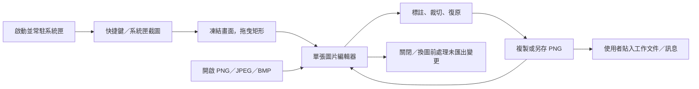

# ScreenshotApp：業務、日常便利與生產力價值機會

分析日期：2026-10-29。程式碼基準：v1.1.0，Git HEAD `77297367289b5a91be15ed42f1d505498f4622fd`；歷史驗收另標示版本與日期。

**第一優先推薦：B01「實色遮蔽與分享前確認」。** ScreenshotApp 已能快速取得與標註圖片，但沒有專用遮蔽工具。對包含帳號、客戶資料或內部資訊的工作畫面，補上這個步驟，才能讓「截圖 → 說明 → 可交付」在同一個本機工具完成。這是依產品用途提出的價值假設；敏感畫面的實際占比與付費需求，資訊不足，無法確認。

本報告先比較 **18 個候選機會**，再依使用者與業務價值選出 Top 5：

| 排名 | 機會 | 核心價值 | 成本判斷 |
|---|---|---|---|
| 1 | B01 實色遮蔽與分享前確認 | 讓原本不能直接分享的畫面，在本機完成交付準備 | 中高 |
| 2 | B02 手動保存可編輯文件 | 把一次性圖片變成日後可修訂的工作資產 | 高 |
| 3 | B03 多圖說明包 | 減少手冊與缺陷回報的逐張命名、排序、補說明與整理 | 高 |
| 4 | B04 可讀且可重用的標註樣式 | 提升成品吸引力、閱讀效率與整套文件的一致性 | 中高 |
| 5 | B05 剪貼簿與拖放匯入 | 讓收到的圖片直接進入編輯，省去中間存檔與尋找檔案 | 中 |

排序不使用「價值除以工期」，也不因容易實作而加分。第 2、3 項即使成本高，仍因修訂與多圖交付的潛在價值排在前段。此排序是產品判斷，不是已量測的 ROI、客群需求排名或開發承諾。

## 1. 分析邊界與證據判讀

- **可確認事實**：目前檔案、原始碼、介面資源或測試案例直接顯示的能力與限制。測試案例存在，不等於本次執行通過。
- **歷史實測**：既有驗收紀錄及畫面，只支持該版本、該環境、該次操作；不外推為所有設備都通過。
- **推論**：從產品情境與能力落差推導的痛點、價值、使用頻率與成本。每項仍需使用者研究驗證。
- **建議**：尚未實作、尚未修改正式規格的方向。尤其現版明文排除的功能，不能視為已核准需求。
- **資訊不足，無法確認**：Repository 沒有足以回答的資料，不能以功能缺少、測試數或主觀喜好代替需求證據。

分析涵蓋 README、完整產品規格、使用說明、已知限制、架構、CHANGELOG、驗收紀錄、規劃 findings，以及設定、文件模型、繪製、文字輸入、剪貼簿、存檔、未匯出保護與發佈的相關 ADR。程式與測試按啟動、截圖、編輯、資料保存、輸出及失敗恢復流程檢視關鍵實作；UI 包含 XAML、文字資源與三張既有實機畫面。程式探索先使用現有 CodeGraph，未索引的 XAML、資源與文件直接讀取，沒有建立索引。

本次未啟動 ScreenshotApp、未操作使用者桌面、未讀取使用者截圖或設定、未重跑建置與測試。僅新增本文件。既有的 [UI／UX 分析](UIUX_VALUE_OPPORTUNITIES.md) 與 [工程任務分析](AUTONOMOUS_GOAL.md) 作為背景參考，未修改，也不把其中的提案當作已存在的功能。本文重新以工作成果、重用與交付流程排序，所以與偏重介面易用性的排序不同。

外部資料僅以官方文件校正差異化判斷，使用 mysearch 擷取原文；沒有進行競品實機評測、定價研究或市場規模估算。來源與限制見第 7 節。

## 2. 整體產品與業務理解

### 2.1 主要使用者與真正要完成的工作

**可確認事實**：規格的主要使用者是個人軟體工程人員，經常製作技術簡報、操作手冊、缺陷回報與架構說明。產品提供 Windows 原生、離線、免帳號、不需管理員權限的截圖與標註流程；主要交付方式是貼入 PowerPoint、Word、Teams，或另存 PNG。[E01](#e01)

| 使用者／情境 | 最終要完成的工作 | 現有產品負責的部分 | 仍需使用者補做的部分／待驗證假設 |
|---|---|---|---|
| 工程人員回報缺陷 | 讓接收者理解錯誤位置與重現方式 | 截圖、箭頭、文字、編號、複製 | 回報欄位與多張圖片的關聯在外部工具整理；敏感內容可能要再用其他工具處理 |
| 操作手冊作者 | 交付一組可依序操作、日後可更新的圖文 | 單張標註、再製、重新編號、PNG | 圖片檔名、跨圖步驟順序、圖說、版本修訂主要靠人工管理 |
| 技術簡報製作者 | 讓觀眾迅速看懂畫面重點 | 裁切、形狀、文字與 Office 剪貼簿輸出 | 成品的可讀性、套圖風格、版面與尺寸仍需逐張處理 |
| 收到別人圖片的同事 | 在既有圖片指出問題後回傳 | 開啟 PNG／JPEG／BMP，使用同一編輯器 | 若來源只在剪貼簿，目前沒有直接貼入整張圖片的入口 |
| QA、客服、教育訓練與內部支援團隊 | 更快交接問題、製作一致說明材料 | 可能沿用以上能力 | **相鄰客群推論**，沒有採用量、決策者、採購流程或願付價格證據 |

前面三類工作直接來自規格；表內的額外工作與痛點是依現有能力推導，不是訪談結果。[E01](#e01)、[E02](#e02)、[E03](#e03)

**業務價值的主要受益者有兩方**：作者少花時間重做、整理與切換；接收者較快看懂、較少追問。持續使用與推薦意願可能因此提高，但無法由 Repository 推算收入。README 記載 Apache License 2.0；目前檢視的產品契約與流程沒有訂閱、計費或帳號服務，也沒有可支持商業轉換率的資料。[E01](#e01)、[E20](#e20)

### 2.2 核心功能與日常流程

| 階段 | 可確認的目前行為 | 產品價值與可能摩擦（推論） |
|---|---|---|
| 導入 | ZIP 解壓縮；沒有安裝程式、簽章或自動更新；正常啟動只進系統匣 | 個人可快速使用；新手可能找不到入口，企業導入可能受執行原則限制，實際阻擋比例未知 |
| 截圖 | 預設 Ctrl+Shift+2；逐顯示器靜態快照；在起始顯示器內拖曳矩形，放開立即開編輯器；Esc／右鍵取消 | 即時單張任務很直接；重複相同範圍、選單或暫態畫面要自行安排 |
| 編輯 | 選取、裁切、矩形、橢圓、直線、箭頭、文字、步驟編號；獨立標註與非破壞性裁切；100 筆復原 | 既有能力足以做基本說明圖；大量標註、跨圖重用與敏感畫面尚有缺口 |
| 進階日常操作 | 右鍵選單、再製、反轉箭頭、重新編號、調整層序、清除標註、還原完整圖片；文字可重新編輯 | 這些已存在，不應重複提案為新功能；可發現性仍可改善 |
| 輸出 | PNG 與 DIB 剪貼簿、PNG 檔；同一合成器；時間戳預設檔名、記住最後成功儲存資料夾 | 跨應用程式交付已成立；檔名本身沒有業務語意，也沒有一組圖的整理能力 |
| 換圖／離開 | 同時只有一份編輯文件；修改後尚未成功匯出才詢問；取消或失敗保留目前內容 | 避免常見誤丟失；但已複製不等於已永久保存，也不等於保留可編輯原稿 |
| 下次修訂 | 原圖與標註存在記憶體；沒有可重新編輯的檔案格式 | 關閉後只剩合併成品時，修改標註可能需要重做 |

依據：[E02](#e02)、[E03](#e03)、[E04](#e04)、[E05](#e05)、[E08](#e08)、[E09](#e09)、[E10](#e10)。

### 2.3 UI／UX：操作便利與畫面吸引力

**可確認事實**：頂端 WrapPanel 放了八種工具、復原／重做、開啟／複製／另存，共 13 個操作；第二列為顏色、線寬、字型、字級與編號值。按鈕已有圖示、文字、存取鍵和工具提示。畫布底部有尺寸、游標、訊息與縮放。這是功能清楚列出的原生工具介面，不是沒有可操作性設計。[E11](#e11)

**推論**：工具、屬性與交付動作的視覺重量接近，使用者要自行判斷下一步；新增工具若只是繼續往同一列加按鈕，尋找成本可能增加。屬性會依「正在輸入文字／選取物件／新增預設」改變作用對象，值得用可見標題說清楚。裁切與文字提交可補明顯的完成入口，但不能直接推論目前使用者經常誤操作。[E12](#e12)

**成品與介面應分開評估**：文字標註目前是單色文字，沒有文字底色、描邊或自動換行；步驟編號已會依圓形底色選黑／白字。讓輸出的說明圖更清楚，對簡報與手冊讀者有直接價值；全介面改用圓角、深色或動畫的效益則尚未證實。[E07](#e07)

設定視窗不可調整大小，內容寬度固定 460 DIP；編輯器最小 720×420 DIP，工具列會換行。既有 Tab 巡覽紀錄只證明部分控制項可到達，不能代表完整鍵盤截圖、放大文字或螢幕閱讀器體驗已通過。這些情境的實際可用程度，**資訊不足，無法確認**。[E11](#e11)、[E16](#e16)

此圖取自 2026-10-19 的既有驗收；漸層為測試底圖，不是應用程式配色。本次亦檢視 [設定畫面](evidence/phase-01/phase1-settings.png) 與 [未匯出提醒](evidence/phase-04/phase4-unsaved-dialog.png)，未以縮放後的圖片宣稱實際字級或對比不合格。[E18](#e18)

### 2.4 資料資產與整合能力

| 現有資料／整合：可確認事實 | 可發展的用途：推論 | 尚未具備或必須釐清的限制 |
|---|---|---|
| ImageDocument：原始圖片、尺寸、裁切範圍、標註清單、歷史與匯出版本 | 保存可編輯文件；支持修訂與再次輸出 | 現有記憶體模型不等於已有檔案格式、版本相容或安全解析能力 |
| Annotation：Id、幾何、顏色、文字／字型／字級或步驟數字；清單順序代表層序 | 重用樣式、批次整理；把步驟轉成可編輯的說明材料 | 步驟數字不是完整的業務流程：沒有跨圖片關聯、步驟圖說或重現條件 |
| History.Version 與 ExportedVersion | 顯示目前內容是否已輸出，降低錯交版本 | 只有共同匯出版本，不能區分目前剪貼簿、各個 PNG 或原稿的狀態；也不能證明對方已收到 |
| settings.json：快捷鍵、開機啟動、最後資料夾、預設顏色／線寬／字級 | 命名樣式、工作情境預設 | 沒有完整樣式集、專案標籤、近期文件；字型不跨編輯視窗保存 |
| PNG／JPEG／BMP 檔案輸入；PNG／DIB 剪貼簿與 PNG 輸出 | 與文件、聊天、Issue 系統以檔案和剪貼簿接續 | 整合是使用者主動貼上／附檔，沒有直接建單、上傳或同步 |
| 全域快捷鍵、單一執行個體喚醒、登入時啟動 | 短操作路徑與未來的明確本機呼叫入口 | 啟動程式沒有處理開檔參數；喚醒事件不帶工作資料，不是公開自動化 API |
| 限量的本機錯誤日誌 | 回報與診斷問題 | 不是使用分析資料，不能得知每日截圖數、留存、功能人氣或產值 |

依據：[E04](#e04)、[E06](#e06)、[E07](#e07)、[E08](#e08)、[E09](#e09)、[E13](#e13)、[E14](#e14)。

**可確認事實**：規格要求離線、無雲端 API、無帳號、無遙測、不自動持久化螢幕內容；架構與已檢視的啟動、輸入輸出流程符合此方向。沒有既有業務資料庫、HTTP API 或多人協作契約可直接沿用。[E01](#e01)、[E19](#e19)

**產品推論**：優先採「使用者主動選取 → 本機處理 → 標準檔案／剪貼簿交付」最符合現有定位。Teams／Office 連接器、雲端圖片庫與自動監控資料夾會引入不同的權限、資料保存與支援責任，不應只因有整合機會就預設加入。

### 2.5 已有品質與驗收邊界

- **既有價值**：非破壞性編輯、100 筆復原、繁中 IME、雙格式剪貼簿、錯誤後保留圖片、存檔不預設覆寫來源，都應保留。[E02](#e02)、[E15](#e15)
- **歷史實測**：ACCEPTANCE 記錄 2026-10-19 Release 建置 0 警告、933 個測試通過；v1.1.0 資料夾版 Phase 3 煙霧驗證 43／43。這些是引用紀錄，本次沒有重跑。[E16](#e16)
- **歷史速度**：v1.0.0 在單一 3456×2160、175% 顯示器上，快捷鍵至覆蓋層中位數 154 ms；600×400 選取完成至編輯器前景中位數 91 ms，各 30 次。沒有證據顯示繼續壓低這些毫秒是最高價值投資；更長的人工整理與切換時間值得先量測。[E16](#e16)
- **相容性界線**：MT-08 的 Office 使用者回報來自 Phase 3、當時只有 DIB；加入 PNG 後仍待確認。混合 DPI、多螢幕、部分常見縮放與乾淨 Windows 執行的 MT 亦有未驗證項目。不能用 README 的功能描述代替這些驗收。[E16](#e16)

## 3. 機會發散：18 個候選

### 3.1 篩選原則

先看「讓使用者完成什麼工作」，再看功能。比較順序為：

1. **能否解除交付障礙**：原本不能直接分享或不能繼續工作的情境，能否完成？
2. **省下多少人工與重做**：減少逐張、逐物件操作，或避免日後從頭修訂？
3. **與主要情境的接近程度**：技術簡報、操作手冊、缺陷回報的效益，優先於尚未確認的相鄰市場。
4. **可操作性與成品吸引力**：作者更好操作，接收者更容易看懂，產出更一致。
5. **採用與持續使用的理由**：能否強化離線、繁中、專注的工作流程，而不增加不必要負擔？

成本、風險與證據信心分開列示。缺少實際使用頻率時，不把主觀分數算到小數點；以下是依上述標準做的順序判斷。**共同假設是主要使用者持續製作工作說明材料，且其中有需遮蔽或日後修訂的圖片**；若多數人只截一次性、無敏感資訊的小圖，排序必須改變。

### 3.2 候選清單與取捨

「現況」欄為事實或明確的能力邊界；改善、價值及成本均為建議／推論。B01～B18 為本文件識別，與其他報告的 O／G 編號無關。

| ID | 候選與現況 | 建議與價值機制 | 篩選結果／未入前五原因 | 成本與主要風險 | 證據 |
|---|---|---|---|---|---|
| B01 | 實色遮蔽：現版沒有專用工具 | 主動框選不透明遮蔽區、檢查輸出；少切換工具，讓工作畫面可交付 | **第 1 名**；優先解除分享障礙 | 中高；漏框、邊緣露出、錯把原稿當成品 | E03、E06～E08 |
| B02 | 可編輯文件：關閉後僅剩合併圖片 | 手動另存原圖、標註與裁切，日後重開修訂 | **第 2 名**；降低重做與文件維護成本 | 高；格式相容、解析限制、敏感原圖保留 | E03、E05、E06 |
| B03 | 多圖說明包：只有單份圖片與時間戳檔名 | 明確收集成品、排序、補圖說，輸出 PNG＋Markdown／本機 HTML | **第 3 名**；處理完整說明交付，而非逐張圖 | 高；順序／版本錯配、保存語意、相容性 | E01、E04、E06、E09 |
| B04 | 標註樣式：僅基本預設，文字無底色／自動換行 | 命名樣式預覽與文字底色；先讓一組圖片讀得清楚且一致 | **第 4 名**；成品品質與反覆製圖受益 | 中高；遮住內容、字型度量與新增選項負擔 | E07、E11、E13 |
| B05 | 直接匯入：整張圖片目前經檔案對話框 | Ctrl+V 貼圖、拖入單張檔案，沿用編輯與換圖保護 | **第 5 名**；消除接圖後的中間存檔與找檔 | 中；文字貼上衝突、格式差異、大圖 | E04、E10～E12 |
| B06 | 情境化工作區：工具與屬性並列 | 分清工具、目前物件／新增預設、交付；補可見提交入口 | 高價值後補；共同流程廣，但現有操作失敗率未知，先不以外觀偏好壓過交付缺口 | 中；熟手習慣、焦點、小工作區 | E11、E12、E18 |
| B07 | 多選與批次整理：一次一個標註 | 框選／多選，一次移動、改樣式與對齊 | 複雜圖受益高；需確認每圖物件數，不能把清除全部與多選混為一談 | 高；混合樣式、群組與復原語意 | E03、E06、E12 |
| B08 | 可信輸出狀態與命名：共用一個匯出版本、時間戳檔名 | 分清目前版本、上次複製／存檔；主動設定檔名前綴，成功後找得到檔案 | 補強既有交付；錯貼與尋檔耗時尚未量測 | 中；外部剪貼簿變更、路徑與覆寫 | E06、E08、E09 |
| B09 | 圖片釘選：沒有浮動參照圖 | 手動釘選唯讀圖片，供跨畫面對照 | 日常便利明確，但需求密度未知，較少直接改善交付成品 | 中；遮住工作區、自家視窗截入 | E03、E04 |
| B10 | 重用選取範圍：每次手動框選 | 本次工作階段記住範圍，可選擇再次擷取 | 同區域多次取圖有價值；目前占比未知 | 中高；顯示器變更、框到錯誤內容 | E02～E04 |
| B11 | 延遲／視窗截圖：即時矩形選取 | 選用倒數與視窗邊界選取，方便選單及暫態畫面 | 擴大可取得素材；仍不解決修訂與交付整理 | 中高；取消、視窗邊界、DPI | E01、E03、E04 |
| B12 | 本機 OCR：沒有文字擷取 | 主動辨識錯誤訊息或畫面文字，校對後複製 | 對錯誤回報有潛力；繁中／程式碼準確率與替代工具使用情形未知 | 高；辨識錯誤、語言套件與離線部署 | E03、E10；W01 |
| B13 | 首次成功與說明入口：啟動只進系統匣 | 可略過的首次說明、Help 與就地操作提示 | 若新手流失是主要問題可升級；目前沒有漏斗資料 | 中；打擾熟手、改變首次啟動契約 | E02、E11、E14 |
| B14 | 可信發佈與企業導入：未簽章、手動更新 | 評估簽章、明確版本與更新／回復程序、乾淨機器驗證 | 若企業禁止執行，應先於功能投資；目前尚無具體採購阻擋證據 | 中高且持續；簽章與交付維護，不保證所有環境放行 | E03、E16、E20 |
| B15 | 前後對照圖：目前單張畫布 | 主動選兩張成品並排、標示前後與差異說明 | QA 與變更說明可能受益；未確認是否比既有文件排版省事 | 中高；尺寸對齊、差異誤判 | E01、E04、E06 |
| B16 | 本機自動化入口：啟動只有喚醒 | 明確的開檔參數或檔案總管入口，讓既有腳本交付圖片 | 有批次流程才成立；不預設背景截圖或上傳 | 中高；單一執行個體傳參、目前文件保護 | E04、E14 |
| B17 | 長截圖：只擷取可見靜態桌面 | 主動捲動擷取與拼接長文件 | 大幅擴張擷取場景，但目前與核心日常工作頻率關聯較弱 | 高；動態內容、重複區塊與拼接錯位 | E01、E03 |
| B18 | 可選恢復工作：無歷史與自動保存 | 先評估記憶體內上一張；磁碟恢復另定明確選用與清除規則 | 可減少意外損失，但沒有當機／遺失頻率，且改變隱私承諾 | 高；未匯出螢幕內容落盤、保留期間；記憶體不能防當機 | E01、E03、E05 |

### 3.3 為何是這五項

B01 回答「這張工作畫面能否交出去」；B02 回答「明天改字時要不要重做」；B03 回答「五張圖如何成為一份可用說明」；B04 回答「接收者能否看清楚，整組圖是否一致」；B05 回答「別人傳來的圖能否立即拿來工作」。五項分別作用於交付門檻、資產生命週期、多圖組織、成品品質與素材取得，避免把同一個 UI 改版拆成多名。

第 2、3 名與第 4、5 名之間的實際價值差距，**資訊不足，無法確認**。本次將可持續修訂與完整文件交付放在前面，是因規格明列操作手冊與技術簡報；若觀察顯示主要是一次性短訊回覆，B05、B06、B08 應往前移。若企業無法安裝或執行，B14 會成為先決條件。

## 4. Top 5 深入評估

### 第 1 名：B01 實色遮蔽與分享前確認

**現況與問題｜可確認事實**：現版明列不提供實色遮蔽、模糊或馬賽克。一般矩形主要畫外框；只有寬或高不超過兩倍線寬時才變成實心，並非獨立的遮蔽功能。畫面與輸出共用繪製器，且輸出同時有 PNG 與 DIB。[E03](#e03)、[E07](#e07)、[E08](#e08)

**痛點｜推論**：要分享含帳號、姓名、內部網址或測試資料的畫面時，使用者可能先存檔，再到別的工具遮蔽；也可能誤以為黑色空心框已遮住資訊。無法由程式碼確認這些情況的頻率，更不能宣稱已有資料外洩事件。

**建議改善**：新增名稱清楚的「實色遮蔽」，拖曳產生完全不透明的矩形，可移動、調整與復原；提供成品預覽，讓使用者檢查範圍。複製與另存都只交付合成後的成品，不能夾帶原圖或可還原標註。遮蔽區須覆蓋該範圍的底圖與敏感標註，不能僅對其中一種內容生效。

**使用者／業務價值｜推論**：把隱私承諾延伸到分享前的實際操作，減少跨工具加工與中間檔案；對工程回報與內部支援，形成「離線完成可分享說明圖」的清楚用途。它主要是補齊交付能力，不能宣稱遮蔽為市場獨有功能。

**預期影響｜待驗證**：含敏感區的任務完成率提高、分享準備時間與外部工具切換下降；試用者在有此需求的工作中更常選用 ScreenshotApp。沒有足夠資料承諾營收、普遍節時比例或資安事件下降率。

**實作成本與風險｜推估中高**：工具本身不大，但須跨模型、互動、復原、裁切及兩種剪貼簿格式驗證。主要風險是框選遺漏、邊緣像素混合、輸出前版本又改變，以及未來與可編輯原稿混淆。原圖在編輯工作階段仍存在記憶體，不能宣稱已銷毀來源。沿用共用繪製器是基礎，不是遮蔽正確性的證明。[E06](#e06)～[E08](#e08)、[E15](#e15)

**反方觀點**：若主要截圖皆為無敏感資料的簡報素材，這項效益會低於樣式或直接匯入；使用者也可能已有足夠順手的替代工具。Microsoft 官方文件已描述 Snipping Tool 的本機 OCR 與快速遮蔽電子郵件／電話，故不能只靠「有遮蔽」說服人改用。[W01](#w01)

**信心**：功能缺口高；對需要遮蔽的任務之價值中；需求覆蓋率與商業收益未知。最重要的反證是：近期工作任務幾乎不需遮蔽，或既有工具沒有造成額外負擔。

### 第 2 名：B02 手動保存可編輯文件

**現況與問題｜可確認事實**：文件在記憶體中保有原圖、裁切與獨立標註；另存 PNG 或複製會合成為成品。沒有可重新編輯的專案格式。複製與另存共用 ExportedVersion；已匯出後關閉，不代表有可修訂原稿。[E03](#e03)、[E05](#e05)、[E06](#e06)、[E09](#e09)

**痛點｜推論**：操作手冊或簡報需要日後改文字、移動箭頭、調整裁切時，手上若只有 PNG，原有物件已無法個別選取。作者可能重截重畫，或在文件軟體補蓋，增加維護成本；實際重做次數未知。

**建議改善**：提供使用者主動「儲存可編輯文件」與「開啟可編輯文件」，保存單張原圖、標註、層序及裁切；另保留明確的「匯出成品」。初期不保存每一步復原歷史，不建立自動截圖庫，也不要求多分頁。重新開啟後能修改現有物件即可驗證核心價值。

**使用者／業務價值｜推論**：把截圖加工時間轉成可延續的成果；產品可以從即時標註工具，擴展為文件作者日後仍會回來使用的工具。對持續維護操作手冊的人，單次修改省下的重做可能大於縮短一次按鈕操作。

**預期影響｜待驗證**：完成指定修訂的時間、需要重新截圖的比例下降；手動保存後再次開啟編輯的比例提高。單看專案檔保存次數不夠，必須觀察是否真的減少重做。

**實作成本與風險｜推估高**：需設計格式版本、檔案大小與解析限制、原子保存、缺少字型時的行為、失敗後保留內容，以及「原稿已保存／成品已輸出」兩種不同狀態。原稿可能包含遮蔽下或裁切外的敏感原圖，介面必須明示「可編輯原稿可能包含原始資訊」，並與可分享成品分開；新增保存操作不等於可以背景自動保存。[E05](#e05)、[E06](#e06)、[E10](#e10)

**反方觀點**：很多截圖只用一次；若原始系統畫面已大幅改版，保留舊原圖仍不能免除重截。專案格式也帶來管理與相容性負擔，可能讓輕量工具變重。因此先限單份、明確手動保存，不把圖片庫、同步與完整版本管理綁進同一項。

**信心**：保存限制高；文件修訂情境的價值中；實際回頭修訂頻率與留存增益未知。若試用者極少再開啟文件，應下調排名，而非以保存功能使用次數自證成功。

### 第 3 名：B03 多圖說明包

**現況與問題｜可確認事實**：產品同時只有一份編輯文件，新圖取代舊圖；步驟編號屬於單張圖片，沒有跨圖關聯或圖說。輸出是單張 PNG／剪貼簿圖片，預設以時間戳命名。規格目標卻包含操作手冊與缺陷回報。[E01](#e01)、[E04](#e04)、[E06](#e06)、[E09](#e09)

**痛點｜推論**：一份五步驟教學或三張圖的缺陷回報，需要在外部整理檔名、順序、說明與附件。截圖已很快，整份材料的完成時間卻可能由這些後段工作決定。Repository 沒有這段時間的量測。

**建議改善**：提供可選的「建立說明包」工作模式。使用者明確把目前完成的圖片加入清單，再新增下一張；清單可排序、移除、填標題與圖說。使用者選擇輸出位置後，產生有順序的 PNG 與引用相對路徑的 Markdown，或附一份本機 HTML 預覽。先保持一次只編輯一張；說明包是明確收集的成果，不是所有截圖的背景歷史。

**使用者／業務價值｜推論**：交付單位從「一張圖」提升為「一份能閱讀的說明」，減少漏步驟、錯附件與人工整理。接收者不需先安裝 ScreenshotApp，便可依交付格式閱讀。這是五項中較有機會形成特定工作流程賣點的方向，但沒有證據證明其他工具都做不到。

**預期影響｜待驗證**：從第一張截圖到完成整份材料的時間下降；檔名、排序與圖說錯配減少；接收者依說明完成任務的成功率提高。應以一份完整交付物計算，不把單張截圖速度當成這項的成功指標。

**實作成本與風險｜推估高**：新增包的標題、項目順序、圖說與成品版本等資料；需處理輸出失敗、部分檔案已存在、圖片與說明一致性，以及圖片數量造成的記憶體負擔。Markdown 不會自動把圖片上傳到任何 Issue 系統，仍需接收端支援或使用者附檔。跨次工作階段保存需另定明確手動保存行為；需修訂單文件與保存相關規格語意，不能偷偷沿用為自動歷史。

**反方觀點**：使用者可能已在 Word、PowerPoint 或既有 Issue 範本中完成這些事；再多一個清單會重複輸入。若只支援 Markdown，Office 作者未必受益。應用同樣的多圖任務比較整段工時，只有比現有工作方式更短且交付品質不下降才擴大。

**信心**：現有單圖邊界高；多圖工作價值中；偏好的交付格式、批次大小與實際需求中低。B03 可先收集合併成品，不必等待 B02 的完整可編輯格式，也不把 B02 的修訂節時重複算進 B03。

### 第 4 名：B04 可讀且可重用的標註樣式

**現況與問題｜可確認事實**：設定保存顏色、線寬與字級，字型只在編輯視窗開著時沿用；沒有命名樣式集。一般文字以單一前景色繪製、不自動換行；步驟編號已有底色亮度對應黑／白字。工具與樣式選項固定呈現在屬性列。[E02](#e02)、[E07](#e07)、[E11](#e11)、[E13](#e13)

**痛點｜推論**：亮、暗與複雜底圖需要不同的文字呈現，同一份簡報中的多張圖也需一致。作者逐張調整，或貼入簡報後另加文字，會降低生產力與成品一致性。紅字在所有底圖都好讀的假設沒有依據。

**建議改善**：先提供少量可預覽的命名樣式，例如「一般說明」「強調」「步驟」，保存相關的字型、字級、顏色與線寬；文字可選不透明底色。樣式只在使用者套用時改變目前物件或新增預設，作用對象清楚顯示。文字框換行、引線標籤、留白與品牌配色可後續驗證，不一次導入完整排版軟體。

**使用者／業務價值｜推論**：作者較少重調；接收者較快讀懂；作品在簡報、教學與產品示範中更有一致性與專業感。這同時改善畫面上的操作辨識與最終成品的吸引力，比單純更換應用程式主題更接近工作價值。

**預期影響｜待驗證**：完成同風格五張圖的時間及調整次數下降；不同底圖下的標註辨識正確率提高；成品接收者對清楚與一致性的評分提高。美觀偏好與理解速度分開記錄，不能互相代替。

**實作成本與風險｜推估中高**：需要樣式資料與預覽，並維持編輯、IME、復原與輸出一致。文字底色可能遮住重要畫面；換行會改變範圍與命中判定；大量預設可能反而增加選擇負擔。既有 TextAnnotationTests、ImageRendererTests 是回歸基礎，不是閱讀品質的證明。[E07](#e07)、[E15](#e15)

**反方觀點**：作者可能喜歡自由配色，且最終版面由公司 PowerPoint 模板決定；過度裝飾會削弱原圖資訊。先驗證文字底色與完整樣式重用，若接收者理解沒有改善，就不擴大到更多裝飾效果。

**信心**：能力與限制高；在成套文件的價值中；偏好樣式與商業吸引力未知。這項不含 B07 的多選批次修改，也不把整個 UI 重做成本藏在「樣式」之下。

### 第 5 名：B05 剪貼簿與拖放匯入

**現況與問題｜可確認事實**：現有圖片入口為截圖或檔案開啟；RegisterCommands 沒有整張圖片貼入命令，EditorWindow.xaml 沒有檔案拖放入口。文字輸入框本來就支援文字貼上；不能把它誤認為圖片匯入。[E04](#e04)、[E10](#e10)～[E12](#e12)

**痛點｜推論**：收到同事、聊天視窗或其他工具的圖片後，若手上只有剪貼簿內容，要先另存或重新截取再編輯；這增加中間檔案、尋檔及可能的品質損失。此路徑的使用頻率，資訊不足，無法確認。

**建議改善**：在編輯器提供「貼上圖片」與單張檔案拖放；沒有編輯器時可由系統匣的明確動作貼圖。沿用目前文件取代前的保護、格式與尺寸檢查；解析失敗保留原文件。文字框有焦點時 Ctrl+V 仍貼文字，且不背景監聽或擷取剪貼簿內容。

**使用者／業務價值｜推論**：讓 ScreenshotApp 成為「任何收到的圖片都能快速補說明」的工具，增加可用場景與日常接觸機會；利用既有 PNG／剪貼簿輸出完成往返，不必先建立各聊天軟體連接器。

**預期影響｜待驗證**：收到圖片至完成標註回覆的時間下降；中間存檔與檔案對話框使用次數下降；輸入不支援內容時能恢復操作。排名來自可能反覆發生的跨工具流程，而非中等實作成本。

**實作成本與風險｜推估中**：剪貼簿可能有 PNG、點陣圖或檔案清單，透明度、尺寸與錯誤處理需一致；拖入多個檔案時要有明確規則。Ctrl+V 的文字／圖片情境衝突，以及編輯中取代文件，是主要 UX 風險。初期可只接受單張與既有檔案格式，不擴張成通用轉檔器。

**反方觀點**：若絕大多數素材都由全域快捷鍵直接擷取，這項不如改善工作區；部分來源本來就能輕鬆存檔，也未必有顯著節時。先用真實的「收到圖片 → 補說明 → 回傳」任務確認，而非只量一次貼上有多快。

**信心**：入口缺口高；該工作路徑的價值中；實際覆蓋率與留存影響未知。B05 只處理輸入端，不把 B08 的命名、輸出狀態與重試一起包成無邊界的專案。

## 5. 第一優先推薦與 MVP

### 5.1 為什麼先開始 B01

**建議先驗證並投入「實色遮蔽與分享前確認」的窄範圍 MVP。** 主要理由是它能讓部分原本不能直接交付的工作畫面，在既有離線流程內完成；同時作用於新截圖與開啟的圖片，與缺陷回報及技術文件的情境接近。後續的樣式或多圖交付，也不應建立在使用者必須先離開工具處理敏感資料的流程上。

這不是因為它最容易。遮蔽的像素、版本與所有輸出格式都需要嚴格確認，成本高於單純新增匯入按鈕。相較之下，B02、B03 的價值較依賴回頭修訂與成套文件頻率；B04 提升閱讀品質，但不能處理畫面尚不適合分享的情況。

**此推薦採用一個尚待驗證的前提**：主要使用者的近期工作中，存在足夠多「需要遮蔽才分享」的任務。Repository 能證明功能缺口，不能證明這個前提。可在開發前以近期任務訪談與不含真實資料的範例任務檢查；不需為本分析新增遙測或收集實際敏感畫面。

### 5.2 建議 MVP 範圍

目標使用情境：工程人員截取測試系統畫面，遮住兩個指定欄位，加入箭頭說明，再複製到接收端或另存 PNG。以下為未來建議，不是本次實作內容。

| MVP 項目 | 使用者看得到的行為 | 可檢查的完成條件 |
|---|---|---|
| M1 明確的實色遮蔽工具 | 預設完全不透明黑色矩形；拖曳後可移動、調整大小、刪除 | 不靠調大一般矩形線寬；任何允許的尺寸都完整填滿指定區域 |
| M2 延續可反悔操作 | 編輯期間可復原／重做，拖曳只算一筆 | 移動、調整、刪除與復原後，預覽及輸出一致；原圖仍只留在本次工作階段 |
| M3 可主動檢查的成品預覽 | 使用者可檢視輸出範圍，放大查看邊界，確認這一版的遮蔽範圍 | 修改內容後原先的確認狀態失效；文案說明是人工確認，不能顯示「已自動移除所有敏感資訊」 |
| M4 所有輸出一致 | 既有 Ctrl+C 與另存 PNG 都使用遮蔽後的合成成品 | PNG 檔、剪貼簿 PNG、DIB 解碼後的遮蔽區一致；輸出不附原圖、隱藏文字或可復原資料 |
| M5 保留快速與離線流程 | 一般未使用遮蔽的截圖流程照常；只有使用者要求複製／儲存才交付 | 不新增自動上傳、背景監聽、截圖歷史或隱藏的磁碟暫存；失敗仍保留文件 |

M3 是可用的檢查步驟，不強迫每張一般圖片多走一個精靈。MVP 先不加入 OCR 自動偵測、模糊／馬賽克、可編輯專案、多圖包、帳號、雲端連接器或全面 UI 改版。工具說明須區分「工作階段內可復原」與「匯出成品不含被遮住的來源像素」；不承諾能控制 Windows 剪貼簿歷史或接收端的保存方式。

### 5.3 未來實作前應明確修訂的產品契約

採納 B01 時，才更新規格中 FR-15 的工具清單、FR-16／FR-22 的編輯與復原、FR-26～32 的成品輸出，以及不提供功能清單。ADR-0010、0011、0014 需說清楚遮蔽資料、繪製順序與多格式輸出；驗收增加遮蔽區及邊緣像素、裁切／縮放、標註重疊、復原與失敗保留。這些是避免誤解產品承諾的必要工作，不是本次要執行的技術重構。[E01](#e01)、[E05](#e05)、[E07](#e07)、[E08](#e08)

## 6. Success Metrics：如何判斷 B01 值得繼續

### 6.1 基準與試驗方法

**下列數字都是建議的驗證門檻，尚未量測，亦非效益承諾。** 現版沒有專用遮蔽功能，基準應是使用者目前完整的工作方式，允許使用其原本的外部工具；不能只拿「ScreenshotApp 做不到」當成新版本無限大的改善。

建議邀請 12 位符合工程回報／文件製作情境的人，每人完成現有方式與 MVP 各三個難度相當的任務，共每個條件 36 次。使用人工製作的假姓名、假帳號、假網址與已知像素圖樣；兩組使用不同但等難素材，交錯先後順序，減少練習效應。計時從取得畫面／素材開始，到在指定接收端確認成品結束，包含遮蔽、標註、檢查與切換工具。

事前統一完成時限（例如每題 5 分鐘）；超時、放棄與失敗都保留在分母，記錄原因，不只比較成功且最快的任務。時間報告同時列成功任務的配對差異與全體任務的完成率／超時率，不能以排除失敗製造節時。12 人僅是形成性研究，不足以宣稱整體市場效果或統計顯著。

### 6.2 指標、定義與建議門檻

| 指標 | 定義與量測方式 | 建議 Success Criteria | 當前基準 |
|---|---|---|---|
| **遮蔽正確性：必要條件** | 解碼 PNG 檔、剪貼簿 PNG 與 DIB；已指定遮蔽矩形含邊界的所有像素都符合不透明填色；交付格式不含來源圖／隱藏文字 | 所有受測輸出 **0 個殘留來源像素**；任一格式失敗即不接受，不能用平均值掩蓋 | 尚無此工具與測試，未量測 |
| **完整任務成功率** | 完成全部指定遮蔽、標註正確、指定接收端可讀的任務數／36；由檢查者對照事前答案 | 至少 **35／36**，且不低於既有方式；任一被當成成功交付的樣本不得漏遮指定資訊 | 未量測 |
| **端到端準備時間** | 同一參與者在等難任務的全流程時間比較，包含外部工具、檔案處理與成品檢查 | 成功任務的配對中位時間降低 **至少 30%**，同時成功率不下降、超時率不上升 | 未量測；不能拿歷史 154 ms 截圖延遲代替 |
| **加工工具切換** | 從取得圖片至完成分享準備，為加工圖片切換到其他編輯工具的次數；最後切到接收端不計 | 中位數 **0 次**，且較原方式減少；基準已為 0 時不宣稱此項改善 | 未量測 |
| **第一次獨立完成** | 第一次任務不靠研究者提示，找到遮蔽、完成調整並輸出的人數／12 | 至少 **10／12**；並能說明普通外框與實色遮蔽的差別 | 未量測 |
| **一般任務效率護欄** | 另做不含敏感內容的基本截圖、箭頭、複製任務，與現版比較 | 中位完成時間不得變慢超過 **10%**；不增加強制確認步驟 | 未量測 |
| **正確性與隱私護欄** | 針對裁切、縮放、重疊標註、修改後再輸出、復原／重做及失敗恢復檢查；稽核檔案與網路副作用 | 相關既有測試維持通過；無新增未經明確儲存的圖像落盤、背景上傳或內容日誌 | 僅有既有功能的歷史紀錄，新增功能未驗證 |
| **持續選用** | 兩週自願試用；只在確實遇到需遮蔽任務的人中，統計一半以上此類任務選用 ScreenshotApp 的比例 | 若有至少 10 位符合條件的試用者，其中至少 **60%** 達成；樣本不足時標示不足，不硬判通過 | 使用頻率與留存均未知 |

像素檢查須涵蓋矩形貼邊、1px 區域、裁切前後、不同檢視縮放、遮蔽移動／刪除／復原，以及遮住文字標註等情境。單靠「肉眼看起來黑了」或 OCR 讀不出來，不足以證明指定像素已被替換。人工確認負責找出該遮的區域，像素檢查負責證明已指定的區域確實被處理；兩者不能互相代替。

Office／Teams 的接收結果需記錄實際版本與格式，不能由剪貼簿 API 回傳成功推定已貼上；本機替身測試亦不能替代接收端實機驗證。[E08](#e08)、[E16](#e16)

### 6.3 繼續、縮減或改變優先順序的條件

- **繼續擴大**：遮蔽正確性與隱私護欄全數通過，任務成功率達標，準備時間有實質改善，且試用者確實遇到並選用此流程。
- **先縮減／修正**：若功能正確但使用者找不到、常漏框，先修正命名、範圍辨識與預覽；不立即加入 OCR 掩蓋基本操作問題。
- **調整排名**：若合格使用者很少有遮蔽需求，或原工具已足夠快，改驗證 B02 的修訂任務或 B05 的接圖回覆任務。沒有頻率資料時，不直接擴張為企業版。
- **不接受**：任何輸出格式仍帶出已指定要遮蔽的內容，或為方便而自動保存原圖，即使操作更快也不能通過。

研究只需自願提供任務種類、時間、切換次數、成功／失敗與採用理由；不要求實際客戶畫面，不新增預設遙測。可用「每週符合任務數 × 每次實測節省分鐘」估算時間效益，但在兩項基準未知時不提供節省工時或營收數字。

## 7. 商業賣點與差異化校正

### 7.1 少量官方對照

| 官方可確認資訊（2026-10-29 查核） | 對本案的含意（推論） |
|---|---|
| W01：Microsoft 的 [Snipping Tool 使用說明](https://support.microsoft.com/en-us/windows/apps/use-snipping-tool-to-capture-screenshots) 已描述擷取文字、快速遮蔽電子郵件／電話，文字辨識在本機處理 | 「離線 OCR」與「能遮蔽」不是獨占賣點；B01 要靠明確的工作流程與可靠交付證明價值。該頁不等於每台使用者電腦都已具備相同版本 |
| W02：[ShareX 官方首頁](https://getsharex.com/) 列有多種擷取、標註、OCR、釘選、擷取後工作與自訂工作流程，並提供繁體中文 | 比功能數量很難形成有說服力的定位；專注於少設定、可理解的繁中工作流程，是可測試的方向，不能聲稱 ShareX 必然難用 |

以上僅查官方能力清單，未操作競品，也未比較繁中品質、速度、易學性或遮蔽實作。競品功能存在不證明本產品使用者不需要它；但會降低把單一功能當成商業護城河的合理性。

### 7.2 能提出的價值主張與尚不能提出的承諾

| 可測試的價值主張 | 對應機會 | 應先取得的證據 |
|---|---|---|
| 「工作畫面在本機完成遮蔽與說明，再交付」 | B01 | 完整任務成功、所有輸出正確、比現有工具組合省時 |
| 「說明圖下次只改需要的部分」 | B02 | 真正發生修訂，重開後少重做，而非只有保存檔案 |
| 「一組截圖直接整理成可交接的說明材料」 | B03 | 整份材料完成時間、錯配率、接收者能否理解與使用 |
| 「每張圖都清楚，整份簡報風格一致」 | B04 | 讀者辨讀與理解結果、成套圖製作時間、偏好評分 |
| 「收到圖片即可補說明回覆」 | B05 | 匯入來源分布、端到端時間、是否減少中間存檔 |

這些可用於產品示範與試用招募；**願付價格、可服務市場、企業採購需求與收入成長，資訊不足，無法確認**。企業服務或付費方案必須另外驗證決策者、允許的部署方式與支援需求，不能從「離線工具」直接推導出可售企業產品。

現版刻意不自動保存與不使用網路，既是限制，也可能是採用理由。B02 的原稿保存、B03 的多圖收集、B18 的恢復機制，都必須清楚區別使用者主動儲存與背景持久化；B01 也只能承諾成品處理正確，不能宣稱符合所有企業政策。

## 8. 資訊不足與可能改變排序的證據

| 未知項目 | 目前結論 | 建議補證據方式與排序影響 |
|---|---|---|
| 每人每日任務數與主要用途分布 | 資訊不足，無法確認 | 自願記錄近期任務；一次性聊天多則 B05／B08 上升，文件修訂多則 B02 上升 |
| 敏感內容的處理頻率與原有工具負擔 | 資訊不足，無法確認 | 以任務種類訪談，不收集敏感原圖；若幾乎沒有此需求，B01 應下調 |
| 多圖數量、圖說格式與文件平台 | 資訊不足，無法確認 | 觀察一份實際工作如何完成；若外部模板已足夠，B03 降級；不能預設 Markdown 適用所有人 |
| 作者之外的閱讀者是否更容易理解 | 資訊不足，無法確認 | 讓接收者依產出完成指定操作，量測錯誤與追問；決定 B03／B04 的實際價值 |
| 重新編輯次數與關閉後重做成本 | 資訊不足，無法確認 | 使用無敏感範例進行隔日修訂，另以自願任務日誌確認頻率；決定 B02 是否值得高投入 |
| 新手流失、小視窗、文字放大與輔助科技體驗 | 資訊不足，無法確認 | 首次完整任務及指定設備驗證；若被阻斷，B06／B13 應優先，不必等新功能 |
| 最新 Office／Teams、混合 DPI、乾淨機器相容性 | 既有驗收仍有明列缺口 | 依發佈版本與環境補驗；若真實流程被阻斷，先恢復既有產品可用性 |
| 企業可否執行未簽章版本、採購與支援要求 | 資訊不足，無法確認 | 訪談實際導入者與管理者；若無法執行，B14 是前提 |
| 改用其他工具的原因、願付價格與市場規模 | 資訊不足，無法確認 | 訪談替代流程與選擇理由；官方功能清單不能代替採用研究 |
| 人力、交付時間與持續維護能力 | 資訊不足，無法確認 | MVP 邊界確認後估工；本文成本僅表示影響範圍與驗證負擔，不能當工期承諾 |

## 9. Repository 證據索引

所有連結相對於本文件；行號以本次基準工作區為準。規格支持產品意圖，原始碼支持目前行為，測試支持被檢查的條件，歷史驗收支持特定環境結果。證據沒有直接證明候選的商業回報。

| 編號 | 來源與定位 | 支持的判斷／證據界線 |
|---|---|---|
| E01 | [ScreenshotApp.Spec.md](ScreenshotApp.Spec.md)，L7–55、L119–241、L319–337、L439–445 | 主要使用者、工作情境、單文件、離線與無自動保存；OCR／遮蔽／專案格式等屬未實作範圍。歷史「v1.1 候選」不代表現版已提供 |
| E02 | [USER_GUIDE.md](USER_GUIDE.md)，L5–139、L141–149 | 啟動、系統匣、八工具、右鍵操作、快捷鍵、屬性、輸出、圖片載入與未匯出提醒 |
| E03 | [KNOWN_LIMITATIONS.md](KNOWN_LIMITATIONS.md)，L5–58 | 未簽章、手動更新、矩形擷取、單選、文字／格式限制、無可編輯格式與未提供功能 |
| E04 | [AppController.cs](../ScreenshotApp/AppController.cs)，L38–50、L61–64、L234–271、L341–403；[CaptureFlow.cs](../ScreenshotApp/Capture/CaptureFlow.cs)，L49–75 | 入口接線、忙碌守衛、開圖、未匯出確認、截圖與單編輯器取代；取消與失敗恢復 |
| E05 | [未匯出保護 ADR](adr/0016-unexported-changes-protection.md)，L14–39；[文件模型 ADR](adr/0010-document-model-and-commands.md)，L12–24 | 無修改圖片不詢問、成功匯出才繼續、禁止自動暫存的取捨；原圖、標註、命令與歷史 |
| E06 | [ImageDocument.cs](../ScreenshotApp/Editor/Model/ImageDocument.cs)，L14–54；[Annotation.cs](../ScreenshotApp/Editor/Model/Annotation.cs)，L28–69、L225–269 | 原圖、裁切、標註、共同匯出版本；標註欄位、矩形空心條件、文字與步驟資料。模型本身不是持久檔案格式 |
| E07 | [AnnotationPainter.cs](../ScreenshotApp/Editor/Rendering/AnnotationPainter.cs)，L17–58、L112–146；[TextLayout.cs](../ScreenshotApp/Editor/Model/TextLayout.cs)，L12–24；[共用繪製 ADR](adr/0011-shared-annotation-painter.md)，L12–22 | 現有標註類型、矩形外框／實心、單色文字、步驟對比與無自動換行；共用繪製不能代替新增遮蔽的證明 |
| E08 | [ImageRenderer.cs](../ScreenshotApp/Export/ImageRenderer.cs)，L15–48；[ClipboardService.cs](../ScreenshotApp/Export/ClipboardService.cs)，L11–26、L42–65；[剪貼簿 ADR](adr/0014-clipboard-formats-and-retry.md)，L14–22、L34–35 | 同一合成結果、PNG／DIB、失敗回報、既有短暫重試；不是接收端已收到的證據 |
| E09 | [PngFileService.cs](../ScreenshotApp/Export/PngFileService.cs)，L10–45；[EditorWindow.xaml.cs](../ScreenshotApp/Editor/EditorWindow.xaml.cs)，L1106–1195；[存檔 ADR](adr/0015-file-writing-and-background-encoding.md)，L14–22 | 時間戳命名、單張輸出、覆寫確認、背景編碼、成功時版本與最後資料夾更新 |
| E10 | [ImageFileLoader.cs](../ScreenshotApp/Export/ImageFileLoader.cs)，L14–84、L93–113 | 檔案輸入、三種格式、1 億像素上限、透明轉白、錯誤回報；沒有直接剪貼簿輸入契約 |
| E11 | [EditorWindow.xaml](../ScreenshotApp/Editor/EditorWindow.xaml)，L7–10、L24–79、L82–240、L243–293；[SettingsWindow.xaml](../ScreenshotApp/Settings/SettingsWindow.xaml)，L7–27、L49–55、L112–120；[UnsavedChangesDialog.xaml](../ScreenshotApp/Editor/UnsavedChangesDialog.xaml)，L20–37 | 工具與屬性配置、文字／提示、尺寸、確認選項；沒有檔案拖放宣告。不證明各種實機設定下的易用程度 |
| E12 | [EditorSession.cs](../ScreenshotApp/Editor/EditorSession.cs)，L9–19、L40–47、L178–222、L388–445、L448–464；[EditorWindow.xaml.cs](../ScreenshotApp/Editor/EditorWindow.xaml.cs)，L230–291 | 八工具、單選、拖曳預覽與提交、再製／重新編號、顏色作用對象；快捷鍵清單沒有整張圖片貼入 |
| E13 | [AppSettings.cs](../ScreenshotApp/Settings/AppSettings.cs)，L6–23；[StyleChoices.cs](../ScreenshotApp/Settings/StyleChoices.cs)，L11–32；[設定 ADR](adr/0004-settings-persistence.md)，L12–21；[USER_GUIDE.md](USER_GUIDE.md)，L71–81；[KNOWN_LIMITATIONS.md](KNOWN_LIMITATIONS.md)，L39 | 保存的偏好與基本樣式選項；字型不跨編輯視窗保存；沒有命名樣式組合 |
| E14 | [App.xaml.cs](../ScreenshotApp/App.xaml.cs)，L14–58；[SingleInstanceGuard.cs](../ScreenshotApp/Platform/SingleInstanceGuard.cs)，L22–56；[TrayService.cs](../ScreenshotApp/Platform/TrayService.cs)，L25–75；[ARCHITECTURE.md](ARCHITECTURE.md)，L314–331 | 啟動無開檔參數處理、具名事件僅喚醒、系統匣入口；限量錯誤日誌不等於產品使用分析 |
| E15 | [DirtyTrackingTests.cs](../ScreenshotApp.Tests/DirtyTrackingTests.cs)，L14–98；[ClipboardServiceTests.cs](../ScreenshotApp.Tests/ClipboardServiceTests.cs)，L54–143；[ImageRendererTests.cs](../ScreenshotApp.Tests/ImageRendererTests.cs)，L34–171；[TextAnnotationTests.cs](../ScreenshotApp.Tests/TextAnnotationTests.cs)，L28–128；[EditorSessionTests.cs](../ScreenshotApp.Tests/EditorSessionTests.cs)，L30–100；[EditorWindowTests.cs](../ScreenshotApp.Tests/EditorWindowTests.cs)，L40–176；[PngFileServiceTests.cs](../ScreenshotApp.Tests/PngFileServiceTests.cs)，L24–92 | 已讀取的關鍵測試涵蓋版本、輸出、裁切、文字修訂、拖曳、右鍵與存檔；本次未執行。未顯示的視窗測試不證明版面與真實焦點 |
| E16 | [ACCEPTANCE.md](ACCEPTANCE.md)，L7–16、L219–254、L275–320 | 歷史 933 通過、延遲條件、v1.1.0 煙霧結果與 MT 缺口；Office 回報的版本限制 |
| E17 | [findings.md](../.planning/2026-10-18-screenshotapp-v1/findings.md)，L132–137、L157–168 | 量測曾因動作未發生與判定器錯誤而失真；裁切像素與未顯示視窗的限制。支持成效驗證須確認動作與基準真的成立 |
| E18 | [v1.1.0 編輯器畫面](evidence/phase-07/release-phase3-cropped-fill.png)、[設定畫面](evidence/phase-01/phase1-settings.png)、[未匯出提醒](evidence/phase-04/phase4-unsaved-dialog.png) | 本次實際檢視的歷史圖像；只支持版面觀察，非本次實機測試 |
| E19 | [ARCHITECTURE.md](ARCHITECTURE.md)，L7–25、L188–212、L258–331 | 整體模組、資料、輸出與保存邊界；沒有把架構改寫當作產品機會 |
| E20 | [README.md](../README.md)，L3–16、L34–45、L89–91；[ScreenshotApp.csproj](../ScreenshotApp/ScreenshotApp.csproj)，L3–19；[發佈 ADR](adr/0017-release-packaging.md)，L20–44；[CHANGELOG.md](../CHANGELOG.md)，L15–28 | 定位、版本、發佈、授權記載與 v1.1.0 已有功能；沒有由此推導付費需求或企業核准 |

## 10. 本次交付範圍

本文件完成整體產品／業務分析、18 個候選、依價值排序的 Top 5、逐項反方觀點、第一優先推薦、MVP、Success Metrics 與可追溯證據。沒有修改 Production Code、測試、正式規格、ADR 或既有分析文件；沒有實作功能、提交 commit、合併、推送或建立 PR。

文件驗證以相對連結、證據定位、必要章節與變更範圍檢查為主，不為這次文件新增執行完整產品測試。未來是否採納任何機會，應以對應任務證據決定；本文不自動啟動後續開發。

